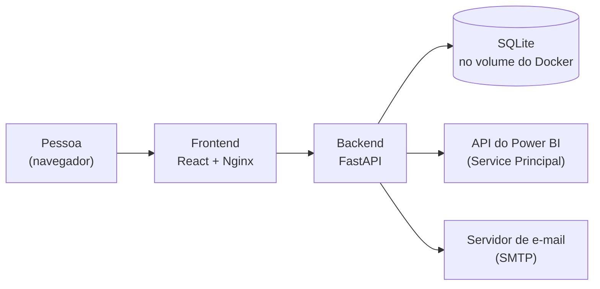

<h1 align="center">
  <picture>
    <source media="(prefers-color-scheme: dark)" srcset="docs/brand/logo-horizontal-dark.png">
    
  </picture>
</h1>

<p align="center">
  <strong>O portal de relatórios Power BI da sua empresa, na sua própria infraestrutura.</strong><br>
  Quem precisa ver o relatório entra com login e senha, sem conta nem licença do Power BI.
</p>

<p align="center">
  <a href="https://github.com/armandonettox/bihoster/actions/workflows/ci.yml"></a>
  <a href="https://github.com/armandonettox/bihoster/releases"></a>
  <a href="LICENSE"></a>
  <a href="https://github.com/armandonettox/bihoster/pkgs/container/bihoster-backend"></a>
</p>

<p align="center">
  <a href="#instalação-docker">Instalação</a> ·
  <a href="#o-que-ele-faz">Recursos</a> ·
  <a href="#como-funciona">Como funciona</a> ·
  <a href="#atualizações">Atualizações</a> ·
  <a href="#desenvolvimento-local-sem-docker">Desenvolvimento</a> ·
  <a href="#licença">Licença</a>
</p>


<p align="center">
  <sub>Os relatórios, os nomes e os números do GIF são fictícios: foram gerados por um Power BI de mentira
  (veja <a href="docs/demo/README.md"><code>docs/demo/</code></a> para regravar o GIF).</sub>
</p>

O BIHoster hospeda e organiza os relatórios do Power BI da sua empresa em coleções, com
controle de acesso por grupo e por pessoa. Os relatórios são embutidos pelo modelo
"app owns the data" (um Service Principal do Azure AD faz a ponte), então ninguém precisa de
licença nem de conta própria no Power BI para ver o que tem permissão. Sobe com um único
`docker compose up -d`, e os dados ficam com você.

## O que ele faz

| | |
|---|---|
| **Relatórios** | Coleções de relatórios do Power BI embutidos, com busca, favoritos, miniaturas, tela cheia com zoom, escolha das páginas que aparecem e um botão **Exportar** que abre uma janela para escolher o que sai (tabelas da página, página atual ou relatório inteiro) e em que formato, como no Power BI (Excel para as tabelas; PowerPoint, PDF ou imagem para a página e o relatório, com valores atuais ou padrão). O **Modo TV** passa os relatórios sozinho numa tela, com pausa e barra de progresso. |
| **Acesso e segurança** | Permissões separadas por grupo e por pessoa, no sistema todo ou por coleção. Horário de acesso por grupo, bloqueio de contas, login com Google, trilha de **auditoria** com reversão de ações, defesas contra escalada de permissão e chaves cifradas no servidor. |
| **Entrega por e-mail** | Envio de relatórios em PDF ou imagem, **assinaturas** recorrentes em dias e horários escolhidos e **alertas** que avisam quando uma medida passa de um limite. Todos os e-mails saem em HTML com a sua marca. |
| **Chat de IA** | Pergunte aos relatórios em linguagem natural. Funciona com OpenAI, Anthropic, Gemini, OpenRouter e NVIDIA, com colunas bloqueáveis por relatório, limite de uso e orçamento. |
| **A sua marca** | Cores, logo, tela de login e telas de erro e de aviso personalizáveis, cada uma com prévia, e o texto de cada e-mail editável. |
| **Operação** | Atualização pelo botão da própria Administração, com **cópia do banco antes**, histórico completo de versões, cache dos tokens de embed e imagens publicadas no GitHub Container Registry. |

## Como funciona



A pessoa só conversa com o frontend. O backend confere quem ela é e o que ela pode ver, pede ao
Power BI o acesso ao relatório e devolve para o navegador exibir. A senha do Service Principal
e as chaves de IA ficam cifradas no servidor e nunca voltam para o navegador.

**Stack:** Python (FastAPI, SQLAlchemy, SQLite) no backend, React com TypeScript e Vite no
frontend, tudo em Docker.

## Início rápido

```bash
git clone https://github.com/armandonettox/bihoster.git
cd bihoster
docker compose up -d
```

Abra `http://localhost:5173`. **A primeira pessoa a se cadastrar vira administradora**, e o
Power BI se configura dentro do próprio app, em Administração. Os detalhes (HTTPS, sessão,
atualizações) estão logo abaixo.

## Instalação (Docker)

Requisitos: [Docker](https://docs.docker.com/get-docker/) e [Docker Compose](https://docs.docker.com/compose/install/).

```bash
git clone https://github.com/armandonettox/bihoster.git
cd bihoster
docker compose up -d
```

Pronto — acesse `http://localhost:5173`. Só essa porta fica exposta no host; o backend (porta
8000) fica acessível apenas pela rede interna do compose, atrás do proxy reverso do próprio
Nginx do frontend. Não é preciso configurar nada antes: a chave de
autenticação (`JWT_SECRET`) e a chave de criptografia dos secrets do Power BI/Google
(`ENCRYPTION_KEY`) são geradas automaticamente no primeiro boot e guardadas no volume
persistente. A primeira pessoa a se cadastrar vira administrador da plataforma.

Se quiser controlar esses valores você mesmo (recomendado em produção exposta publicamente),
copie `.env.example` para `.env` e preencha antes do `docker compose up -d`.

### Configurar o Power BI

Toda a configuração do Power BI (Service Principal do Azure AD: tenant, client ID, client
secret) é feita dentro do próprio app, em **Administração → Geral**, depois de logado como
administrador — não precisa editar nenhum arquivo.

### Forçar HTTPS atrás de proxy

Se você coloca o BIHoster atrás do seu próprio reverse proxy (nginx, Caddy, Traefik) que
termina o TLS e repassa a requisição em texto claro pro backend, defina
`TRUST_PROXY_HEADERS=true` no `.env` antes de ativar **"Forçar HTTPS"** em Administração → Geral.
Sem isso, o backend nunca enxerga a conexão como HTTPS de verdade e entra num loop de redirect
301. **Nunca ative essa variável se o backend estiver exposto direto na internet sem proxy na
frente** — qualquer cliente poderia forjar o header e escapar dessa checagem.

### Duração da sessão

A sessão de login se renova sozinha enquanto a tela estiver aberta, então o **Modo TV** e as abas
paradas não caem a cada hora. Para não existir sessão eterna, há um limite absoluto desde o
login, controlado por `SESSION_MAX_HOURS` no `.env` (padrão **168**, ou seja, 7 dias): depois
disso é preciso entrar de novo. Trocar a senha também encerra a renovação das sessões antigas.
`SESSION_MAX_HOURS=0` desliga o limite — só faça isso se aceitar que uma sessão roubada nunca
expira enquanto alguém a mantiver aberta.

### Atualizações

**Administração → Atualizações** mostra a versão instalada, se há uma versão mais nova
publicada (com as notas dela) e o histórico de tudo o que mudou em cada versão. O botão
**Verificar atualizações** consulta o GitHub na hora, sem precisar configurar nada.

O histórico não depende do GitHub: ele vem junto com o sistema, do arquivo
`backend/app/changelog/CHANGELOG.md`, então sempre bate com a versão instalada. Cada versão é
uma seção `## 1.2.3 - 2026-01-31 - Título curto`, da mais recente para a mais antiga, com texto
em Markdown simples (listas, títulos com `###`, **negrito**, `código`, links e imagens). Para
mostrar uma imagem ou um GIF animado, coloque o arquivo (`.png`, `.jpg` ou `.gif`, de preferência
abaixo de 2 MB) em `backend/app/changelog/img/` e cite na seção com
``; só imagens dessa pasta são carregadas. **Toda tag nova
precisa da sua seção nesse arquivo antes de ser criada**: a CI usa a mesma seção para criar a
Release no GitHub (sem ela, cai para as notas automáticas do GitHub).

Por padrão, atualizar continua sendo manual: `git pull` (se você clonou o repo) e
`docker compose pull && docker compose up -d`. Nenhum dado é perdido nesse processo — o banco,
os uploads e os segredos gerados automaticamente (`JWT_SECRET`/`ENCRYPTION_KEY`) ficam em
volumes Docker nomeados, separados da imagem.

Se quiser o botão **"Atualizar agora"** da aba fazendo isso sozinho, defina
`ENABLE_AUTO_UPDATE=true` no `.env` antes de subir. Isso dá ao container do backend acesso ao
socket do Docker do host (`/var/run/docker.sock`) para rodar `docker compose pull`/`up -d`
sozinho — **é um acesso root-equivalente ao host**, então só ative se confiar totalmente na
máquina onde está rodando. O container detecta sozinho, ao subir, o GID do grupo dono do
socket montado e ajusta a própria permissão antes de trocar para o usuário sem privilégios
(`docker-entrypoint.sh`) — não precisa rebuildar nem informar nada manualmente.

Como a atualização pelo botão funciona: o `docker compose` não roda dentro do backend (ele é
recriado no meio da troca e levaria o comando junto), e sim num container auxiliar descartável,
que usa a mesma imagem e os mesmos volumes e se remove sozinho no fim. O nome do projeto, a pasta
do projeto no servidor e os arquivos do compose (inclusive o `docker-compose.override.yml`, se
você usa um) são lidos dos rótulos que o próprio compose gravou no container, então a pilha
atualizada é a mesma que já está rodando. O backend precisa enxergar o socket do Docker e a pasta
do projeto (`.:/deploy:ro`), como no `docker-compose.yml` da raiz; se o seu override troca a lista
de volumes (`volumes: !override`), repita esses dois itens nele. O botão **não reescreve o `.env`**
(a pasta é só leitura): depois de atualizar pelo botão, o `APP_VERSION` do `.env` fica na versão
antiga, então ajuste-o antes de rodar `docker compose up -d` à mão. O log de cada atualização fica
em `update_logs/` no volume de dados.

**Antes de atualizar, o sistema copia o banco** para `backups/` no volume de dados (com a API de
cópia do SQLite, que é consistente com o sistema em uso; o `.env` também é copiado, se a pasta do
projeto estiver montada). Ficam guardadas as 5 cópias mais novas, e **se a cópia falhar a
atualização nem começa**. Para restaurar uma cópia: `docker compose cp backend:/app/data/backups/<arquivo>.db .`
traz o arquivo para a sua máquina; com o sistema parado (`docker compose stop backend`),
`docker compose cp ./<arquivo>.db backend:/app/data/bihoster.db` coloca a cópia no lugar e
`docker compose start backend` volta a subir.

## Usuários, grupos e permissões

Tudo isso fica em **Gerenciar usuários** (menu de módulos, no canto superior), separado da Administração:
as pessoas, os grupos e o que cada um pode fazer, numa tela só, com as visões **Por membro** e **Por grupo**.

- **Permissões separadas.** Cada coisa que dá para fazer tem a sua permissão (ver uma coleção, publicar, editar ou
  excluir relatório, criar assinatura, gerenciar a IA, adicionar membro, ver a auditoria etc.). As que têm várias
  partes aparecem agrupadas, com um interruptor para ligar todas e outros para ligar uma a uma.
- **Por coleção ou no sistema todo.** Uma permissão vale numa coleção específica ou em todo o sistema.
- **Grupo e pessoa.** Um grupo tem uma lista de permissões; uma pessoa recebe a soma das permissões de todos os grupos
  dela mais as que foram dadas só para ela. Permissão só soma, nunca nega.
- **Só se dá o que se tem.** Quem recebe o poder de dar permissões, de gerenciar grupos ou de adicionar membros só
  consegue dar e tirar o que ele mesmo tem. Colocar alguém num grupo é dar as permissões do grupo, então vale a mesma
  regra, e o grupo Administradores é só de quem já é administrador da plataforma.
- **Administrador da plataforma** (grupo Administradores) tem tudo. Nenhuma permissão dá esse papel.
- **Pedir mais tempo fora do horário.** Quem cai na tela de "fora do horário" pode escrever o motivo e pedir mais tempo.
  Quem tem a permissão "Liberar acesso fora do horário" vê o pedido no topo de Gerenciar usuários (e recebe um e-mail, se
  o servidor de e-mail estiver configurado), aprova escolhendo por quanto tempo (de 15 minutos a 24 horas, ou até um
  horário do dia) ou recusa, com um motivo se quiser. A liberação acaba sozinha no prazo, pode ser encerrada antes, e a
  tela de quem pediu entra sozinha quando aprovam, e a pessoa também recebe um e-mail com a resposta (e o prazo, se aprovado). Ninguém libera o próprio acesso. Fora do horário, entrar com a
  senha certa dá uma sessão que só serve para essa tela; todo o resto do sistema continua fechado.
- **Assinaturas e alertas: o que é seu e o que é de outras pessoas.** Cada permissão de assinatura e de alerta (ver,
  editar, excluir, enviar agora) vale só para o que a própria pessoa criou. Para ver ou mexer no que outras pessoas
  criaram existem permissões à parte ("... de outras pessoas"), uma para cada ação, que também exigem a permissão
  simples correspondente. Quem não pode ver as de outras pessoas só enxerga as próprias nas listas. Assinatura ou alerta
  cuja pessoa criadora foi removida conta como de outra pessoa. Exportar por e-mail continua uma permissão só. Quem
  atualiza de uma versão anterior não perde nada: no primeiro boot, quem já tinha cada permissão ganha a equivalente
  "de outras pessoas".
- **Módulos Alertas e Assinaturas.** Duas páginas no menu de módulos mostram todos os alertas e todas as assinaturas do
  portal (permissões "Ver os alertas de todo o portal" e "Ver as assinaturas de todo o portal"). Dali dá para criar
  (escolhendo o relatório), editar, pausar e excluir, e enviar uma assinatura na hora. Cada botão segue as permissões da
  coleção do relatório; a visão geral só mostra, não dá acesso a mais nada.
- **E-mails de conta.** Com o servidor de e-mail e o endereço do site configurados (Administração), ao adicionar um
  membro dá para ligar o aviso por e-mail com o link para entrar (desligado por padrão). O mesmo envio, e o do link de
  nova senha, estão no menu dos 3 pontinhos de cada pessoa. O link de nova senha vai só para o e-mail da pessoa.
- **Texto dos e-mails.** Os e-mails que o sistema escreve (adicionado ao sistema, convite, redefinição de senha, pedido de
  mais tempo, horário liberado, pedido recusado, assinatura pausada, alerta de medida e o de teste) saem em HTML, com o nome, a cor e o logo da marca, e em texto
  puro para quem não vê HTML. Em Administração > E-mail dá para ajustar o assunto, a mensagem e o texto do botão de cada um,
  ver a prévia e mandar um teste. A mensagem aceita dados entre chaves, como `{empresa}`, e uma linha que usa um dado vazio
  é omitida. O texto digitado nunca vira HTML. Os relatórios enviados por assinatura ou pelo botão de enviar saem no mesmo
  layout, com o assunto e a mensagem de cada envio (esses não são editados nesta aba). O logo do topo é o da marca, ou um logo só dos e-mails enviado em Administração > E-mail. Para a logo aparecer no e-mail, preencha o endereço do site em Administração > Geral.
- **Horário de acesso.** Cada grupo pode ter faixas de dias e horas (por exemplo "Seg a Sex, 08:00 às 12:00" e "13:00 às 18:00")
  em que as pessoas dele podem usar o sistema, no fuso definido em Administração. A pessoa também pode ter uma exceção
  individual (faixas próprias ou sem limite), que substitui o horário dos grupos. Quem está em mais de um grupo com
  faixas entra quando qualquer um permitir; sem faixa em lugar nenhum, não há limite. Fora do horário a sessão cai na
  hora, uma tela mostra o horário permitido e quando o acesso volta, e ela volta sozinha quando o horário abre.
  Administradores nunca são limitados, e quem tem a permissão "Definir horários de acesso" não muda o próprio horário.
- **Bloquear e desbloquear.** No mesmo menu, quem tem a permissão "Bloquear e desbloquear" impede uma pessoa de entrar:
  a sessão aberta cai na hora e nada é apagado. Não dá para bloquear a própria conta nem o último administrador ativo.

Quem atualiza de uma versão anterior não perde nada: no primeiro boot, os papéis antigos (Leitor, Editor,
Administrador de cada coleção) e as permissões de IA e de analíticos dos grupos são copiados, uma vez, para as
permissões novas. As tabelas antigas continuam no banco, sem uso.

## Desenvolvimento local (sem Docker)

```bash
# backend
cd backend
python -m venv .venv
.venv\Scripts\activate  # Windows; source .venv/bin/activate no Linux/Mac
pip install -r requirements-dev.txt
uvicorn app.main:app --reload

# frontend (outro terminal)
cd frontend
npm install
npm run dev
```

## Desenvolvimento local (com Docker, buildando do código-fonte)

O `docker-compose.yml` da raiz é o de produção/self-host (puxa as imagens publicadas no GHCR).
Pra testar uma mudança local antes de virar uma tag, use o compose de dev, que builda a partir
do código:

```bash
docker compose -f docker-compose.dev.yml up -d --build
```

## Licença

[GNU Affero General Public License v3.0](LICENSE) — se você hospedar uma versão modificada
como serviço para terceiros, é obrigado a disponibilizar o código-fonte das suas modificações.
