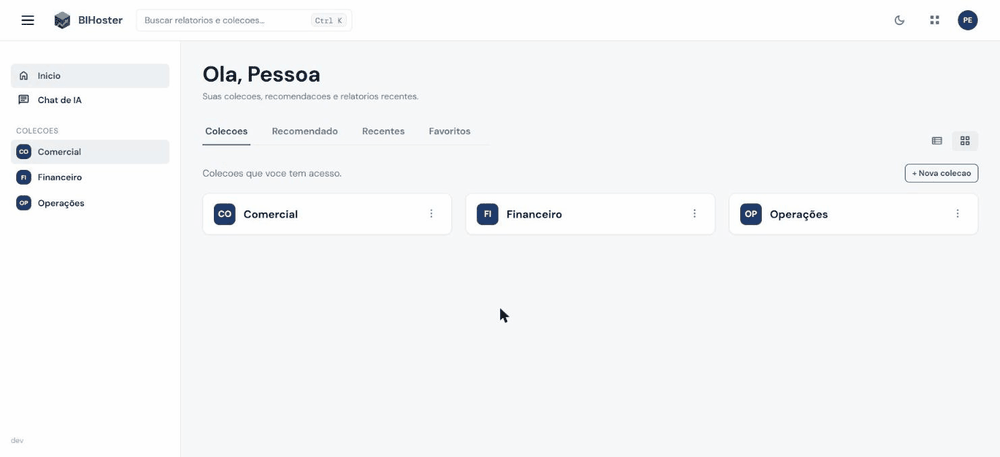

<h1 align="center">
  <picture>
    <source media="(prefers-color-scheme: dark)" srcset="docs/brand/logo-horizontal-dark.png">
    
  </picture>
</h1>

Portal self-hosted para hospedar e gerenciar relatórios do Power BI, com autenticação de
usuários, controle de acesso por grupo e por pessoa, com permissões separadas, e embedding via "app owns the data" (Service Principal
do Azure AD) — os usuários acessam os relatórios sem precisar de licença/conta própria no
Power BI.



## Instalação (Docker)

Requisitos: [Docker](https://docs.docker.com/get-docker/) e [Docker Compose](https://docs.docker.com/compose/install/).

```bash
git clone https://github.com/armandonettox/bihoster.git
cd bihoster
docker compose up -d
```

Pronto — acesse `http://localhost:5173`. Só essa porta fica exposta no host; o backend (porta
8000) fica acessível apenas pela rede interna do compose, atrás do proxy reverso do próprio
Nginx do frontend. Não é preciso configurar nada antes: a chave de
autenticação (`JWT_SECRET`) e a chave de criptografia dos secrets do Power BI/Google
(`ENCRYPTION_KEY`) são geradas automaticamente no primeiro boot e guardadas no volume
persistente. A primeira pessoa a se cadastrar vira administrador da plataforma.

Se quiser controlar esses valores você mesmo (recomendado em produção exposta publicamente),
copie `.env.example` para `.env` e preencha antes do `docker compose up -d`.

### Configurar o Power BI

Toda a configuração do Power BI (Service Principal do Azure AD: tenant, client ID, client
secret) é feita dentro do próprio app, em **Configurações → Power BI**, depois de logado como
administrador — não precisa editar nenhum arquivo.

### Forçar HTTPS atrás de proxy

Se você coloca o BIHoster atrás do seu próprio reverse proxy (nginx, Caddy, Traefik) que
termina o TLS e repassa a requisição em texto claro pro backend, defina
`TRUST_PROXY_HEADERS=true` no `.env` antes de ativar **"Forçar HTTPS"** em Configurações → Geral.
Sem isso, o backend nunca enxerga a conexão como HTTPS de verdade e entra num loop de redirect
301. **Nunca ative essa variável se o backend estiver exposto direto na internet sem proxy na
frente** — qualquer cliente poderia forjar o header e escapar dessa checagem.

### Duração da sessão

A sessão de login se renova sozinha enquanto a tela estiver aberta, então o **Modo TV** e as abas
paradas não caem a cada hora. Para não existir sessão eterna, há um limite absoluto desde o
login, controlado por `SESSION_MAX_HOURS` no `.env` (padrão **168**, ou seja, 7 dias): depois
disso é preciso entrar de novo. Trocar a senha também encerra a renovação das sessões antigas.
`SESSION_MAX_HOURS=0` desliga o limite — só faça isso se aceitar que uma sessão roubada nunca
expira enquanto alguém a mantiver aberta.

### Atualizações

**Configurações → Atualizações** mostra a versão instalada, se há uma versão mais nova
publicada (com o changelog da release) e o histórico de versões — consultando as releases
públicas do GitHub, sem precisar configurar nada.

Por padrão, atualizar continua sendo manual: `git pull` (se você clonou o repo) e
`docker compose pull && docker compose up -d`. Nenhum dado é perdido nesse processo — o banco,
os uploads e os segredos gerados automaticamente (`JWT_SECRET`/`ENCRYPTION_KEY`) ficam em
volumes Docker nomeados, separados da imagem.

Se quiser o botão **"Atualizar agora"** da aba fazendo isso sozinho, defina
`ENABLE_AUTO_UPDATE=true` no `.env` antes de subir. Isso dá ao container do backend acesso ao
socket do Docker do host (`/var/run/docker.sock`) para rodar `docker compose pull`/`up -d`
sozinho — **é um acesso root-equivalente ao host**, então só ative se confiar totalmente na
máquina onde está rodando. O container detecta sozinho, ao subir, o GID do grupo dono do
socket montado e ajusta a própria permissão antes de trocar para o usuário sem privilégios
(`docker-entrypoint.sh`) — não precisa rebuildar nem informar nada manualmente.

## Usuários, grupos e permissões

Tudo isso fica em **Gerenciar usuários** (menu de módulos, no canto superior), separado da Administração:
as pessoas, os grupos e o que cada um pode fazer, numa tela só, com as visões **Por membro** e **Por grupo**.

- **Permissões separadas.** Cada coisa que dá para fazer tem a sua permissão (ver uma coleção, publicar, editar ou
  excluir relatório, criar assinatura, gerenciar a IA, adicionar membro, ver a auditoria etc.). As que têm várias
  partes aparecem agrupadas, com um interruptor para ligar todas e outros para ligar uma a uma.
- **Por coleção ou no sistema todo.** Uma permissão vale numa coleção específica ou em todo o sistema.
- **Grupo e pessoa.** Um grupo tem uma lista de permissões; uma pessoa recebe a soma das permissões de todos os grupos
  dela mais as que foram dadas só para ela. Permissão só soma, nunca nega.
- **Só se dá o que se tem.** Quem recebe o poder de dar permissões, de gerenciar grupos ou de adicionar membros só
  consegue dar e tirar o que ele mesmo tem. Colocar alguém num grupo é dar as permissões do grupo, então vale a mesma
  regra, e o grupo Administradores é só de quem já é administrador da plataforma.
- **Administrador da plataforma** (grupo Administradores) tem tudo. Nenhuma permissão dá esse papel.
- **E-mails de conta.** Com o servidor de e-mail e o endereço do site configurados (Configurações), ao adicionar um
  membro dá para ligar o aviso por e-mail com o link para entrar (desligado por padrão). O mesmo envio, e o do link de
  nova senha, estão no menu dos 3 pontinhos de cada pessoa. O link de nova senha vai só para o e-mail da pessoa.
- **Bloquear e desbloquear.** No mesmo menu, quem tem a permissão "Bloquear e desbloquear" impede uma pessoa de entrar:
  a sessão aberta cai na hora e nada é apagado. Não dá para bloquear a própria conta nem o último administrador ativo.

Quem atualiza de uma versão anterior não perde nada: no primeiro boot, os papéis antigos (Leitor, Editor,
Administrador de cada coleção) e as permissões de IA e de analíticos dos grupos são copiados, uma vez, para as
permissões novas. As tabelas antigas continuam no banco, sem uso.

## Desenvolvimento local (sem Docker)

```bash
# backend
cd backend
python -m venv .venv
.venv\Scripts\activate  # Windows; source .venv/bin/activate no Linux/Mac
pip install -r requirements-dev.txt
uvicorn app.main:app --reload

# frontend (outro terminal)
cd frontend
npm install
npm run dev
```

## Desenvolvimento local (com Docker, buildando do código-fonte)

O `docker-compose.yml` da raiz é o de produção/self-host (puxa as imagens publicadas no GHCR).
Pra testar uma mudança local antes de virar uma tag, use o compose de dev, que builda a partir
do código:

```bash
docker compose -f docker-compose.dev.yml up -d --build
```

## Licença

[GNU Affero General Public License v3.0](LICENSE) — se você hospedar uma versão modificada
como serviço para terceiros, é obrigado a disponibilizar o código-fonte das suas modificações.
