<!--
Histórico de versões do BIHoster. A aba Administração > Atualizações lê este arquivo, e a CI usa a seção da versão
para criar a Release no GitHub.

Formato de cada versão (a mais recente primeiro):

## 1.2.3 - 2026-01-31 - Título curto da versão
Texto em Markdown simples: listas com "- ", títulos com "### ", **negrito**, `código`, links http(s), imagens e GIFs.
Imagens e GIFs ficam em backend/app/changelog/img/ e entram do mesmo jeito: 
Aceita .png, .jpg e .gif (o GIF anima sozinho). Mantenha cada arquivo abaixo de uns 2 MB: eles vão dentro da imagem do sistema.

Toda tag nova precisa de uma seção aqui antes de ser criada.
-->

## 1.55.1 - 2026-11-28 - Título repetido no horário do relatório
- Na seção de **horário de acesso do relatório** (painel de permissões), o título aparecia duas vezes. Agora aparece só uma.
- Ajuste só de aparência (frontend): sem mudança de banco, de permissões ou de comportamento.

## 1.55.0 - 2026-11-25 - Saída de relatório com RLS (desligada por padrão)
- Nova chave em **Administração > Geral: Permitir saída de relatório com RLS**. Ela vem **desligada** e, desligada, tudo continua como antes: relatório com segurança por linha (RLS) não sai por e-mail, arquivo nem TV.
- Ligada, a identidade de cada saída é a de **quem recebe**, nunca a de quem criou: **assinaturas e envio por e-mail** geram **um arquivo por destinatário**, com as funções de cada um, e só recebe quem tem conta no portal e função mapeada no modelo; a **exportação** (PowerPoint, PDF e imagem) usa as funções de **quem exporta**; no **Modo TV** quem monta a lista escolhe uma **função de segurança** entre as que ele mesmo tem, e a TV confere de novo, na hora de passar, se essa pessoa ainda a tem.
- **Falha fechada**: sem função mapeada no modelo, ou com a pessoa sem nenhuma função, nada sai. O chat de IA continua fora.
- Cada envio ou exportação com RLS vai para a **auditoria**, com o id de quem recebeu e as funções usadas (nunca os endereços de e-mail).

## 1.54.0 - 2026-11-25 - Cache e capacidade: aberturas por hora, aquecimento só do que é usado e pausa da capacidade (desligada)
- A aba **Cache** virou **Cache e capacidade**. Ela mostra as **aberturas por hora** de cada relatório (só a contagem; nunca quem abriu) e tem a opção **Aquecer só os relatórios abertos recentemente** (nas últimas 72 horas, ajustável). Ela vem **desligada**: por padrão tudo continua sendo aquecido, como antes.
- O token de embed e os dados do relatório agora são guardados **por relatório**, e não pela pasta por onde a pessoa chegou. O mesmo relatório em várias pastas deixa de gerar um token por pasta, e quando o modelo tem funções de segurança mapeadas elas continuam fazendo parte da chave. O acesso continua sendo conferido antes de qualquer cache.
- **Pré-carga do Power BI no navegador** ganhou uma chave (Administração > Cache e capacidade). Ela já rodava sempre, então **vem ligada**; desligue se a rede for restrita. Há ainda uma orientação sobre o **cache de consultas do modelo**, que é um ajuste do próprio Power BI (só modelos Import em capacidade Premium ou Embedded) e que o BIHoster não liga por você.
- **Pausar e retomar a capacidade do Power BI pelo Azure**, por agenda ou por botão: tudo **desligado** por padrão e em **modo simulado**, que só registra o que seria feito. Só chama o Azure de verdade com a chave geral ligada, os campos do Azure da conta preenchidos e o modo real escolhido com confirmação. Cada ação fica na auditoria.

## 1.53.0 - 2026-11-25 - Assinaturas e alertas por relatório e horário de acesso de cada relatório
- **Assinaturas e alertas por relatório.** Quem recebe `assinatura.*` ou `alerta.*` **só num relatório** (por Gerenciar permissões ou por Gerenciar usuários) passa a poder usar ali: ver, criar, editar, excluir e enviar agora, sem abrir os outros relatórios da pasta. Vale a soma do que foi dado no relatório com o que a pasta dá. A regra do que é da própria pessoa continua: "editar" mexe só no que ela criou, e "editar as de outras pessoas" precisa estar dado **naquele relatório**. As listas do módulo Assinaturas e Alertas oferecem só os relatórios em que a pessoa pode criar.
- **Horário de acesso por relatório.** Em Gerenciar permissões de um relatório (para quem pode definir horários), a seção **Horário de acesso do relatório** define os dias e horas em que ele pode ser **aberto ou exportado**. Fora das faixas, a pessoa vê o horário permitido e quando volta. Sem faixas, não há limite (o padrão). Administradores da plataforma nunca são limitados, uma liberação temporária aprovada abre o relatório até o prazo, e gerenciar ou editar o relatório não depende do horário. O horário soma-se ao horário de acesso de cada pessoa.

## 1.52.0 - 2026-11-25 - Permissão por conta do Power BI e agenda da sincronização à vista
- A permissão **Sincronizar o catálogo** agora pode ser dada **só numa conta do Power BI**, a grupos e a pessoas, além de continuar valendo em todas as contas quando é dada no geral. Quem recebe numa conta só sincroniza **aquela** conta: o botão Sincronizar, o acompanhamento, a escolha dos workspaces e a agenda dessa conta passam a conferir a permissão dela, e as outras contas continuam fechadas.
- Dá para gerenciar isso no cartão da conta (menu **"..." > Gerenciar permissões**, para quem edita permissões) e também em **Gerenciar usuários**, na seção nova **Contas do Power BI** de cada pessoa e de cada grupo, com **Adicionar conta** por busca. É o mesmo dado nos dois lugares. Só se dá o que se tem, e o grupo Administradores não precisa de linhas. Contas **não** têm convite por e-mail: a pessoa precisa já ter conta no portal.
- Cada cartão de conta mostra a **agenda da sincronização automática**: "desligada" (o padrão) ou "a cada 6 horas · próxima em ... · última em ...". A janela Sincronizar mostra a **próxima rodada automática**. A rotina de fundo continua **desligada por padrão**: só sincroniza sozinha a conta em que alguém escolheu um intervalo, e um erro numa rodada não derruba a rotina.
- Excluir uma conta, uma pessoa ou um grupo apaga as permissões de conta que eles tinham.

## 1.51.0 - 2026-11-25 - Módulo Relatórios refeito, com permissões de modelo semântico
- O **Catálogo** e a tela **Acessos aos relatórios** viraram **um módulo só, Relatórios**, parecido com o Power BI Service. A entrada é a **lista dos workspaces do tenant** (nome, quantos relatórios e modelos, última sincronização) com busca; ao abrir um, aparecem os **relatórios e os modelos semânticos** dele numa tabela só. O endereço `/catalog` continua valendo e `/report-access` leva para ele.
- Dentro do workspace há **um botão principal, Sincronizar**, filtros por tipo (Todos, Relatórios, Modelos semânticos), busca instantânea e as colunas Nome, Tipo, Pastas, Atualizado, **Acesso** (pilha de rostos com a contagem) e **RLS**. A coluna de próxima atualização só aparece quando o sistema já tem a informação. Ao passar o mouse numa linha surgem **Abrir** e **Compartilhar**, e o menu **"..."** tem Gerenciar permissões, Segurança dos dados, Pastas, **Atualizar agora** e **Histórico de atualização** (nos modelos).
- **Gerenciar permissões** abre um **painel lateral**: a lista de quem tem acesso (pessoas e grupos, com rosto, nome, o nível e **de onde vem o acesso**: direto, pasta ou herdado de uma pasta de cima), um campo só para **adicionar pessoas ou grupos** com autocompletar e, se você digitar um **e-mail** sem cadastro, a opção de **convidar**. Os níveis são **Ver**, **Ver e exportar** (modelos: **Ver e atualizar**) e **Gerenciar**, e **Personalizar** abre os itens um a um. Cada mudança **grava na hora e dá para desfazer**.
- **Seleção em várias linhas** mostra uma barra com **Compartilhar** e **Pastas**, e as duas pedem a **confirmação do que vai mudar** antes de gravar (inclusive quando relatórios do catálogo passam a ser publicados). Tudo entra ou nada entra.
- Um indicador discreto mostra **quantos relatórios novos estão sem acesso** (por workspace e no topo) e filtra com um clique. Um botão alterna entre **Lista** e **Linhagem** (cada modelo com os relatórios que o usam). A lista é paginada e ordenável no servidor: nunca traz tudo de uma vez.
- **Modelos semânticos apareciam vazios.** A causa: a lista só olhava o que a sincronização trouxe, e nenhuma sincronização tinha rodado, embora os relatórios já cadastrados apontassem para modelos. Agora o modelo é a **união** do que a sincronização trouxe com o modelo de cada relatório cadastrado; o nome vem do Power BI quando a sincronização roda e, até lá, aparece o **código curto do modelo**. Nada some por não ter sido sincronizado.
- **Permissões de modelo semântico**, para pessoas e grupos, por modelo: **Ver o modelo**, **Atualizar o modelo**, **Ver o histórico de atualização**, **Configurar a segurança do modelo** (a mesma permissão geral continua valendo em todos) e **Compartilhar o modelo**. Só soma, só se dá o que se tem, tem convite por e-mail e entra na auditoria. **Ver o modelo não dá acesso aos relatórios que o usam.** Quem só recebeu um relatório ou um modelo também vê o módulo, só com o que recebeu. Pedir a atualização e ver o histórico passam a conferir a permissão do modelo.
- Em **Gerenciar usuários**, a tela de cada pessoa e de cada grupo ganhou as seções **Relatórios** e **Modelos semânticos**: a lista do que foi dado direto, o nível de cada um (edita no lugar, com desfazer) e **Adicionar relatório/modelo** por busca. É a **mesma informação** do painel do módulo: mudar num lugar muda no outro. Na pessoa, **"O que esta pessoa vê e por quê"** agora é paginado e com busca, **sem o limite de 2000**.
- A pilha de rostos, o painel e a tabela foram revisados nos temas claro e escuro e no celular.

## 1.50.0 - 2026-11-25 - Funções de RLS e OLS por grupo e por pessoa
- No **Catálogo > Modelos semânticos**, cada modelo ganhou o botão **Segurança** (para quem tem a nova permissão **Configurar a segurança dos modelos**): dá para dizer que **função** do Power BI cada **grupo** e cada **pessoa** recebe naquele modelo. As funções (de RLS e, no Power BI, também de OLS) precisam existir no modelo: o portal **não cria nem altera** funções, só escolhe quem recebe qual.
- Ao abrir um relatório do modelo, o portal manda no token a **soma das funções** dos grupos da pessoa e das dadas a ela, além do e-mail que já mandava. Quem recebe mais de uma função vê a soma delas, como no Power BI.
- **Falha fechada:** com ao menos uma função mapeada, o modelo passa a **exigir função**: quem não receber nenhuma **não abre** os relatórios dele (nunca cai para "ver tudo"), **nem administradores**. Para os administradores, crie no modelo uma função **sem filtro** e dê a ela o grupo Administradores.
- **Sem nenhuma função mapeada, nada muda:** o modelo continua funcionando exatamente como antes. A tela avisa isso e a lista de modelos mostra quantas funções cada um tem.
- O botão **Testar função** pede ao Power BI um token com aquela função e mostra se ele a aceitou (o token nunca é mostrado nem guardado). Ele confirma que o nome existe, mas **não** o que a função deixa ver: isso se confere abrindo o relatório como a pessoa.
- Mudou o mapeamento ou saiu do grupo? O token antigo **não é reaproveitado**: as funções fazem parte da chave do cache, e gravar a segurança descarta o que estava guardado. Quem sai do grupo deixa de abrir o relatório na hora, mesmo com token ainda válido no cache.
- Opção **RLS só por função** (desligada por padrão): para modelos em que nenhuma regra usa o usuário (como `USERNAME()`), pessoas com o mesmo conjunto de funções dividem o mesmo token e gastam menos capacidade. O token compartilhado usa um nome de usuário neutro, então uma regra que dependa do usuário não mostra dado de ninguém. **Em dúvida, deixe desmarcada.**
- Excluir um grupo ou uma pessoa apaga as funções mapeadas para eles. Cada mudança de segurança entra na auditoria.
- **Continuam bloqueados** nos relatórios com RLS: assinatura por e-mail, exportação (PowerPoint, PDF e imagem), Modo TV e chat de IA. Liberar essas saídas exige identidade por destinatário e validação com dados reais, e fica para quando houver como testar.

## 1.49.0 - 2026-11-25 - Pastas dentro de pastas e relatório em várias pastas
- As coleções agora podem ficar **dentro de outras coleções**, em até **5 níveis**. Ao criar ou editar uma coleção há o campo **Dentro de**; mover uma pasta leva junto tudo o que está dentro dela. Não dá para pôr uma pasta dentro dela mesma nem de uma pasta que ela contém.
- **As pastas de dentro herdam o acesso da pasta de cima.** Quem vê "Financeiro" vê também "Financeiro > Faturamento" e os relatórios delas, e uma subpasta pode ter uma permissão extra, só dela. A herança **só soma**: por isso não existe jeito de esconder uma subpasta de quem vê a pasta de cima. Para ter uma pasta restrita, crie-a no topo ou dentro de uma pasta que essa pessoa não vê.
- Quem só tem acesso a uma subpasta vê as pastas de cima **apenas como caminho de navegação** (só o nome, sem o conteúdo e sem poder abrir). Dentro de uma coleção aparecem o **caminho** (Financeiro / Faturamento) e as **subpastas** que a pessoa acessa; na tela inicial ficam só as pastas de topo.
- Novo item de permissão **Criar subpastas**, dado numa pasta (vale também nas de dentro): é ele que permite criar pastas lá dentro e mover pastas para lá. Criar uma pasta de topo continua sendo **Criar coleções**.
- **O mesmo relatório pode aparecer em várias pastas, sem ser cadastrado de novo.** Ao editar um relatório, o campo **Aparece em** escolhe as pastas (precisa de "Publicar relatório" em cada pasta que ganha ou perde o relatório). O acesso vale por qualquer uma das pastas: quem vê uma ou outra abre o relatório, e não ganha acesso aos outros relatórios dela. Dar uma pasta a um relatório da **Raiz** o **publica** nela; tirar de todas as pastas o devolve para a Raiz.
- **Excluir uma pasta nunca apaga relatório.** Os relatórios dela passam para a outra pasta em que já apareciam ou, sem outra, voltam para a **Raiz**, com as permissões dadas direto neles. Uma pasta com subpastas só é excluída depois de mover ou excluir as de dentro. Excluir um relatório pelo caminho de uma pasta onde ele só aparece tira apenas daquela pasta.
- A busca encontra os relatórios pela pasta em que a pessoa os vê, e o aviso de quanto uma permissão de coleção libera agora conta as subpastas e os relatórios vinculados. "Redirecionar quando há uma coleção só" passa a contar as pastas de topo.
- Tudo é inerte até alguém usar: nenhuma pasta fica dentro de outra e nenhum relatório aparece em mais de uma pasta por conta própria.

## 1.48.0 - 2026-11-25 - Acesso por relatório
- Agora dá para dar acesso a **um relatório só**, a grupos e a pessoas, sem abrir a coleção inteira. Quem recebe um relatório abre esse relatório e **nenhum outro** da mesma coleção: a coleção não aparece para ela e a lista dela continua escondida.
- O acesso a um relatório é a **soma** do que foi dado nele com o que a coleção dele já dá. Tudo o que foi dado por coleção até hoje **continua valendo, sem nenhuma ação sua**.
- Itens que valem num relatório: **ver**, **compartilhar**, exportar, editar os dados, excluir, atualizar os dados no Power BI, assinaturas e alertas. Cada item já traz o que ele exige (exportar exige ver). Tirar o **ver** de um relatório tira também o que depende dele.
- Nova página **Acessos aos relatórios** (menu de módulos): uma matriz **relatório por grupo**, com o que cada grupo tem direto e o que vem da coleção, busca, filtro de **Raiz** ou coleções e paginação. Dá para marcar vários relatórios e **dar ou tirar o mesmo acesso a um grupo ou a uma pessoa de uma vez**. Antes de gravar, a tela avisa quando entre os escolhidos há relatórios da Raiz: **dar acesso a um relatório da Raiz é a forma de publicar o que veio do tenant**.
- Na mesma página, a aba **O que uma pessoa vê** mostra cada relatório que ela abre e **de onde vem o acesso**: direto na pessoa, por um grupo ou pela coleção.
- Na tela inicial, quem recebeu relatórios soltos ganha a aba **Compartilhados**, que só aparece quando há algum.
- Só se dá e só se tira o que se tem: quem tem **Compartilhar** num relatório dá a outros só o que ele mesmo tem **naquele relatório**, e nunca mexe em outro. O grupo Administradores não recebe linhas (já vê tudo).
- Dá para **convidar por e-mail já com acesso a relatórios**: quem já tem conta recebe na hora, e quem ainda não tem fica reservado no convite.
- Os botões de exportar, atualizar dados e a abertura do relatório passam a conferir o acesso **ao relatório**, e não só à coleção.
- Excluir um relatório, uma coleção, um grupo ou uma pessoa apaga também os acessos por relatório que eles tinham. Cada mudança de acesso entra na auditoria.
- **Ainda não** vale por relatório: assinaturas e alertas (continuam pela coleção), horário de acesso por relatório e permissão por conta do Power BI. Ficam para uma versão seguinte.

## 1.47.0 - 2026-11-25 - Catálogo do Power BI e sincronização do tenant
- Cada conta do Power BI ganhou o botão **Sincronizar** (Administração, Contas do Power BI). Ele traz para o portal os relatórios e os **modelos semânticos** publicados no tenant, em segundo plano e com andamento na tela. Rodar duas vezes seguidas não duplica nada.
- O que vem do tenant entra numa coleção interna chamada **Raiz**, que **só administradores enxergam**. Ela não aparece como coleção em lista nenhuma, não pode ser editada nem excluída, e **ninguém recebe acesso a um relatório importado** até você dar a permissão: importar não publica nada.
- Relatórios que já estavam cadastrados à mão **ficam onde estão, com o mesmo nome e as mesmas permissões**: o sistema só anota a data da sincronização e o workspace de origem.
- Relatório que deixa de aparecer no Power BI fica marcado como **Não encontrado**, mas continua no portal com as permissões. Nada é apagado. Se uma leitura falhar (sem permissão no workspace, por exemplo), os relatórios daquele workspace **não** são marcados como removidos.
- Na janela do botão dá para **escolher quais workspaces importar** (por padrão, todos) e ligar a **sincronização automática** (a cada hora, 6, 12 horas, todos os dias ou toda semana). Por padrão ela vem **desligada**: só roda quando você clicar. Quando o Power BI limita as chamadas, a sincronização espera e tenta de novo.
- Novo módulo **Catálogo** no menu de módulos, com a lista de **relatórios** (workspace de origem, onde está, estado e data da última sincronização) e a lista de **modelos semânticos** (quantos relatórios usam e se exigem segurança por linha). Tem busca, filtros e paginação.
- Três permissões novas, que só somam: **Sincronizar o catálogo** (`conexao.sincronizar`), **Ver o catálogo de relatórios** (`relatorio.catalogo`) e **Ver o catálogo de modelos semânticos** (`modelo.catalogo`). Nenhuma delas dá acesso ao conteúdo dos relatórios.
- O aquecimento de cache **não** aquece os relatórios importados: o catálogo pode ter centenas e ninguém os abriu ainda.
- Cada sincronização e cada mudança de configuração entram na auditoria.

## 1.46.0 - 2026-11-24 - Modo TV sem recarregar
- Na TV, páginas seguidas do mesmo relatório agora só trocam de página: o relatório não recarrega mais a cada troca.
- Novo campo **Atualizar os dados** no cadastro da TV: de quanto em quanto tempo (de 1 minuto a 1 hora) o relatório que está na tela busca os dados novos, sem recarregar e sem perder a página. O padrão é não atualizar sozinho.
- O fundo preto da tela da TV não aparece mais atrás dos visuais do relatório: o fundo agora é o mesmo do portal.

## 1.45.1 - 2026-11-24 - Imagens no histórico e passeio refeito
- O histórico de versões ganhou imagens das telas de várias versões: o novo **Modo TV**, o botão **Exportar**, os módulos na barra lateral e no topo, o menu de 3 pontinhos, **Alertas**, **Assinaturas**, **Gerenciar usuários**, **Auditoria** e as abas **Cache** e **IA**. Clique numa imagem para ampliar.
- O GIF do passeio pelo sistema foi refeito com as telas novas e sem os rótulos que a ferramenta de gravação deixava nos quadros.

## 1.45.0 - 2026-11-24 - Novo Modo TV, com TVs cadastradas, link secreto e código de acesso
- O **Modo TV** saiu de dentro das coleções e virou um **módulo próprio**, no menu de módulos do topo e na barra lateral.
- Cada **TV** é cadastrada com um nome e tem a sua própria **programação**: páginas de vários relatórios (até de coleções diferentes), **imagens** (PNG, JPG, GIF ou WebP, até 10 MB) e **vídeos do YouTube por link**, cada item com o seu **tempo** e na ordem que você escolher. Cada vídeo pode tocar com ou sem som.
- Agora a TV troca **de página**, e não só de relatório: cada item da lista é uma página, então um relatório com várias páginas passa por todas elas.
- Cada TV tem um **link secreto**, que dá para copiar ou abrir em outra aba, e que não precisa de login. Ao abrir o link, a TV pede um **código de 6 dígitos que muda a cada 5 minutos** (como a dupla autenticação). O código aparece no cadastro da TV. Depois do código certo, a TV fica conectada pelo **tempo configurado na própria TV**, que pode ser "para sempre". Toda nova conexão pede o código.
- Dá para **desconectar** a TV a qualquer hora e **trocar o link** (o antigo para de funcionar). Errar o código muitas vezes tranca a TV por alguns minutos.
- **Permissões por TV**, para pessoas ou grupos: **ver e utilizar** (ver a programação, abrir o link, ver o código e desconectar) e **modificar** (também editar, trocar o link, mudar o tempo de conexão e excluir). Quem assiste a TV não precisa ter acesso às coleções dos relatórios. Criar TVs é uma permissão geral nova, **Criar TVs**, e quem cria recebe "modificar" na própria TV.
- Quem monta a programação só escolhe relatórios que ele mesmo pode ver. Relatórios com segurança por linha (RLS) não passam na TV.
- Os relatórios que estavam marcados como "Modo TV" nas coleções foram movidos para a seção **Painéis**, e o tempo da TV deixou de existir nas coleções: monte a TV nova no módulo.
- As ações das TVs (criar, editar, conectar, desconectar, trocar o link, mudar permissões) entram na auditoria.

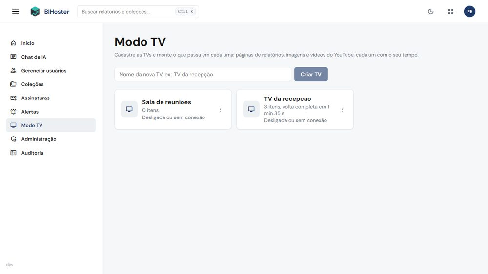

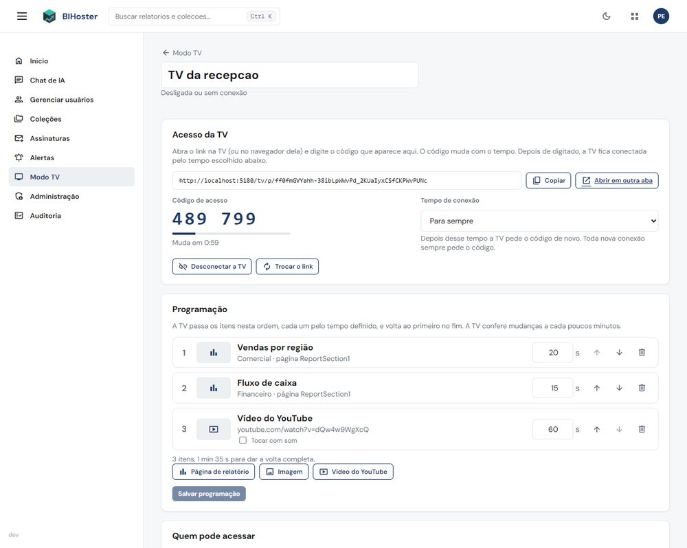

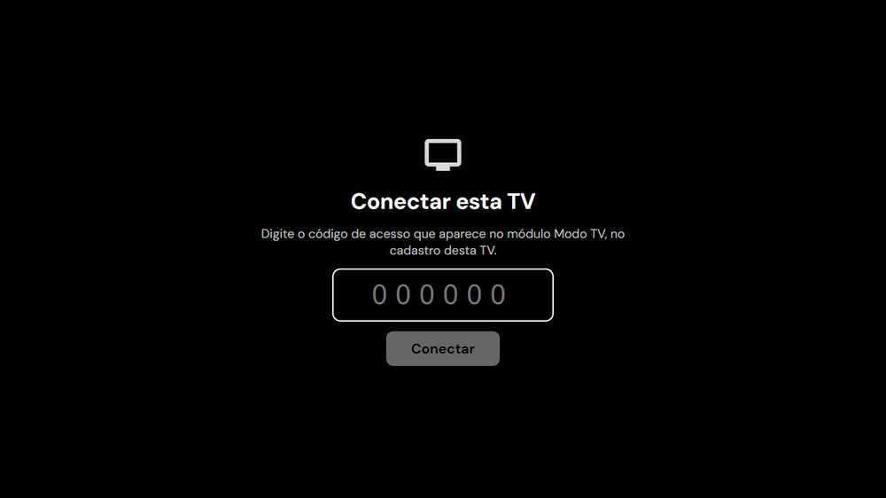

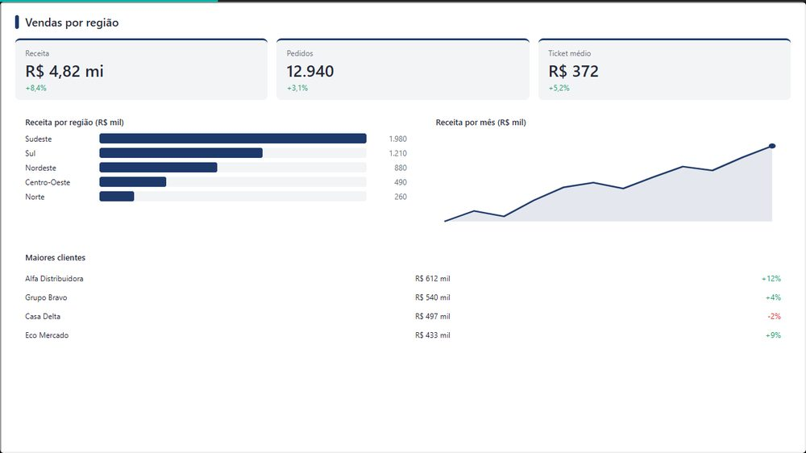

## 1.44.0 - 2026-11-24 - Escolher quais páginas e quais tabelas exportar
- Nas janelas de **PowerPoint, PDF e imagem**, a caixa "Exportar somente a página atual" deu lugar a uma **lista suspensa com todas as páginas do relatório**, com seleção múltipla e busca. Marque as páginas que quer, e só elas são exportadas. Sem nada marcado, vai o relatório inteiro.
- Na janela do **Excel**, uma lista suspensa igual deixa escolher **quais tabelas** da página saem na planilha, cada uma numa aba.
- A lista de páginas mostra só as páginas que a pessoa pode ver no relatório (as escolhidas para ele, sem as ocultas) e é lida assim que o relatório carrega.

## 1.43.0 - 2026-11-24 - Exportar mais parecido com o Power BI, com PowerPoint
- O botão **Exportar** agora funciona como o do Power BI: abre uma lista de formatos, cada um com o seu **logo** (Excel, PowerPoint, PDF e imagem), e ao escolher abre a janela do formato.
- Novo formato: **PowerPoint (.pptx)**, gerado pelo Power BI.
- A opção **CSV** foi retirada: as tabelas agora saem só em **Excel**.
- Nas janelas de PowerPoint, PDF e imagem você escolhe **Valores Atuais** (com os filtros e seleções que estão na tela) ou **Valores Padrão**, e pode **exportar somente a página atual**.
- A janela do Excel mostra qual tabela exportar, e as tabelas da página agora são lidas assim que a página desenha, então a janela abre na hora, sem esperar a procura.
- Ao clicar em **Exportar**, a janela **fecha na hora** e a exportação segue **em segundo plano**: um aviso animado no canto da tela mostra o andamento (com a porcentagem quando o Power BI informa), o botão do topo gira enquanto exporta e o arquivo baixa sozinho. Dá para continuar usando o relatório, ou até sair dele, e pedir outro formato ao mesmo tempo. Se falhar, o aviso fica na tela com o motivo.
- A exportação ficou mais rápida: o sistema passou a perguntar ao Power BI se o arquivo já está pronto a cada 1 segundo (antes eram 3) e a tela a cada 1 segundo (antes eram 2), com a primeira consulta em meio segundo. O tempo que o próprio Power BI leva para gerar o arquivo não muda.

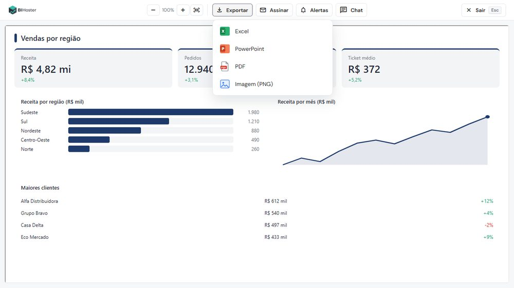

## 1.42.1 - 2026-11-24 - Módulos de volta ao topo
- O botão de quadradinho dos módulos voltou para a barra do topo. Os módulos agora aparecem nos dois lugares: no topo e na barra lateral.

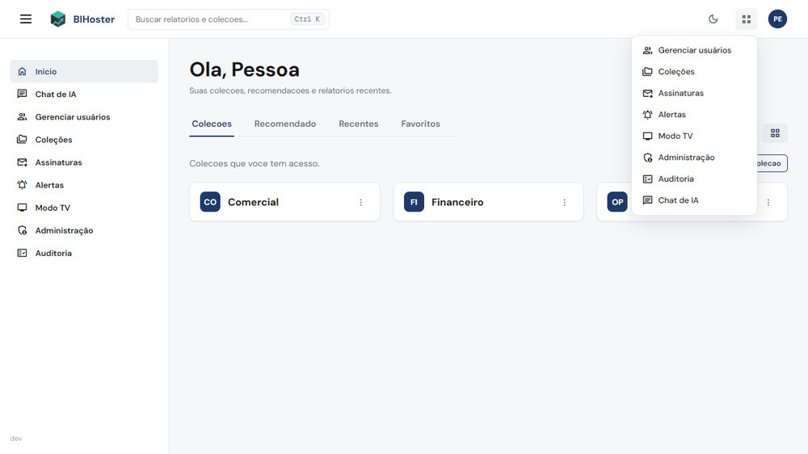

## 1.42.0 - 2026-11-24 - Módulos na barra lateral
- Os módulos (Gerenciar usuários, Coleções, Assinaturas, Alertas, Administração e Auditoria) agora também ficam na **barra lateral**, logo abaixo de Início e Chat de IA. Cada um só aparece para quem tem permissão, e o módulo da página aberta fica destacado. (Nesta versão o botão de quadradinho do topo sumiu por engano; a 1.42.1 o devolve.)
- A lista de coleções saiu da barra lateral, já que agora existe o módulo **Coleções**. As coleções continuam acessíveis pelos cartões da página Início e pelos Favoritos.

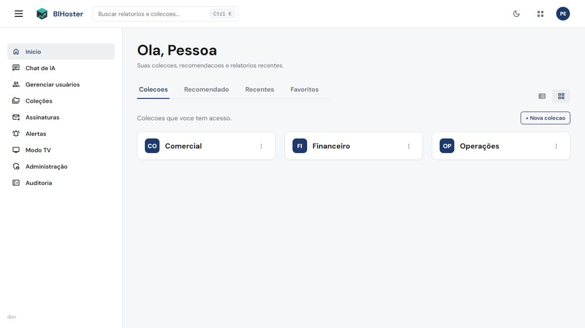

## 1.41.2 - 2026-11-24 - Ícones em todos os menus dos 3 pontinhos
- Todas as opções dos menus dos 3 pontinhos agora têm ícone: cartão da coleção, ações do relatório (favoritar, enviar por e-mail, atualizar miniatura, editar, excluir), topo da página da coleção, conexões do Power BI e campo de imagem.

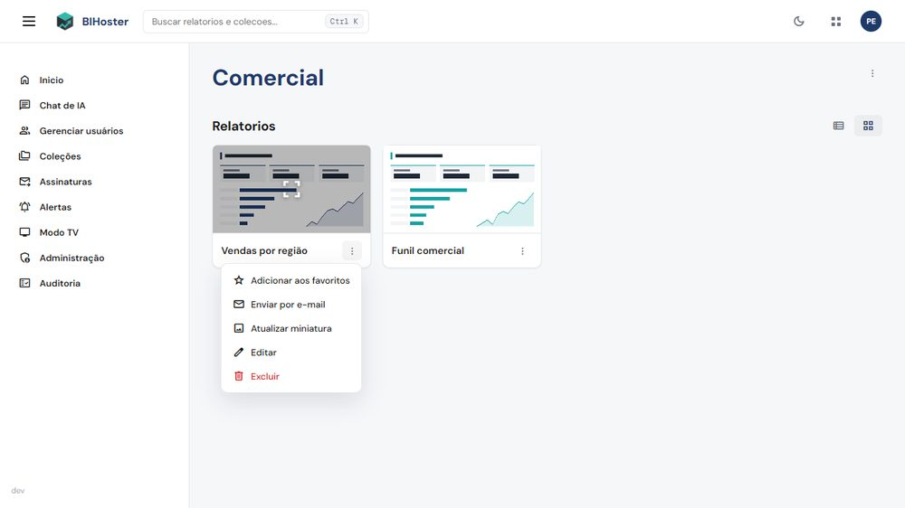

## 1.41.1 - 2026-11-24 - Janela Exportar abria escondida
- Corrige o botão **Exportar** da versão 1.41.0: a janela abria, mas ficava atrás da tela cheia do relatório e por isso parecia que nada acontecia. Agora ela aparece por cima.

## 1.41.0 - 2026-11-23 - Exportar em janela, com Excel, PDF e imagem
- O botão **Exportar** do topo do relatório agora abre uma janela suspensa, onde você escolhe **o que exportar** (tabelas da página, página atual ou relatório inteiro) e **como** (CSV ou Excel para as tabelas; PDF ou imagem para a página e o relatório).
- **Excel (.xlsx):** as tabelas saem como planilha, com o cabeçalho em negrito e a primeira linha congelada. Ao exportar todas as tabelas, cada uma vira uma aba do mesmo arquivo.
- **PDF e imagem:** o Power BI gera o arquivo, o que leva alguns segundos (a janela mostra o andamento), e o download começa sozinho. Imagem do relatório inteiro vem num zip, com uma imagem por página.
- PDF e imagem pedem a permissão de exportar da coleção e não funcionam em relatórios com segurança por linha (RLS), como o envio por e-mail. Quem não tem a permissão continua exportando as tabelas.
- Cada exportação de PDF ou imagem fica registrada na auditoria.

## 1.40.0 - 2026-11-23 - Imagens do histórico pequenas e padronizadas
- As imagens e GIFs do histórico de versões agora aparecem todas no mesmo tamanho pequeno, alinhadas à esquerda, em vez de cada uma com um tamanho diferente.
- Clique numa imagem para ampliar numa janela, com os botões **Abrir em outra aba** e **Fechar** (o Esc e o clique fora também fecham).

## 1.39.0 - 2026-11-23 - Ações de alertas e assinaturas no menu dos 3 pontinhos
- Nas páginas **Alertas** e **Assinaturas**, as ações de cada linha (Enviar agora, Pausar ou Reativar, Editar e Excluir) ficam agora numa janela suspensa dos 3 pontinhos, cada opção com seu ícone. A tabela fica mais limpa e igual ao resto do sistema.
- O botão dos 3 pontinhos só aparece quando a pessoa pode usar alguma ação daquela linha, e a janela abre solta da tela, sem ser cortada nas últimas linhas.

## 1.38.0 - 2026-11-23 - Módulo Alertas e assinaturas editáveis
- Novo módulo **Alertas** (menu de módulos, para quem tem a permissão "Ver os alertas de todo o portal"): lista os alertas de todas as coleções, com filtro e resumo de quantos estão ativos ou com erro.
- Dá para **criar** um alerta novo escolhendo o relatório, **editar**, **pausar** ou **reativar** e **excluir**, tudo na própria página. Se o sistema não conseguir listar as medidas do relatório, basta digitar o nome da medida.
- A página **Assinaturas** deixou de ser só de consulta: agora também cria assinaturas (escolhendo o relatório), edita, pausa, envia na hora e exclui.
- Cada botão só aparece quando a pessoa pode usá-lo naquela coleção, e o servidor confere de novo. Quem só é editor de uma coleção continua mexendo apenas no que criou, a não ser que tenha a permissão de mexer no de outras pessoas.

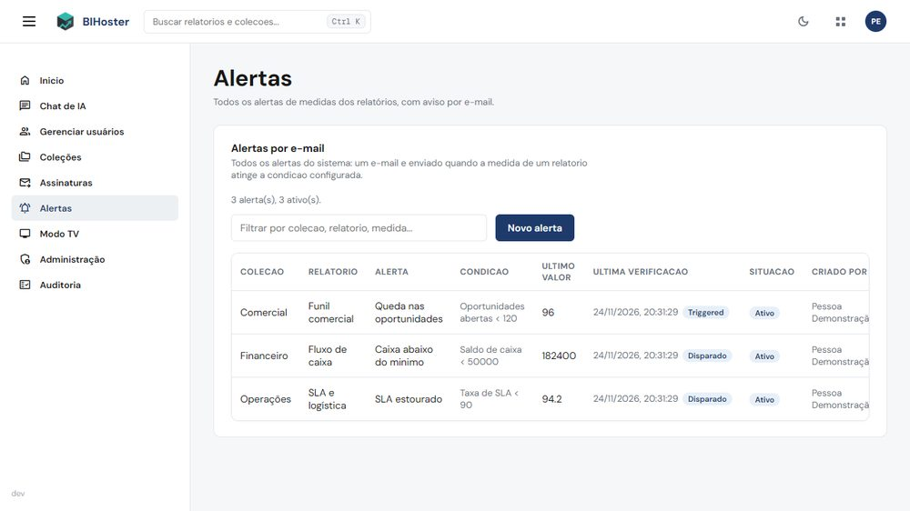

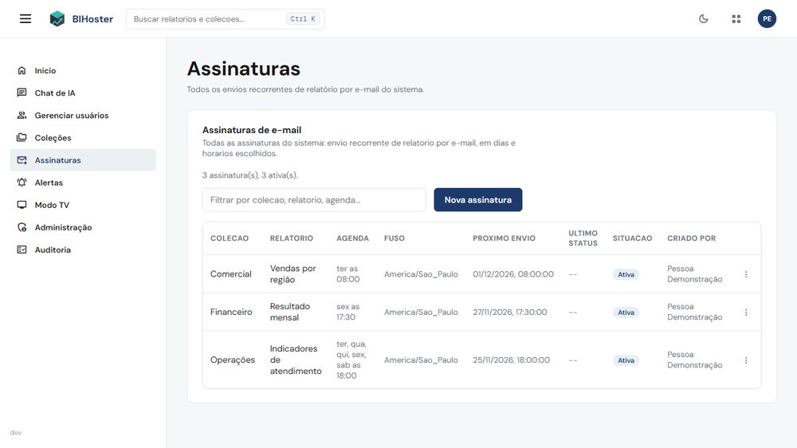

## 1.37.0 - 2026-11-23 - Imagens e GIFs no histórico de versões
- O histórico passou a mostrar imagens das telas em várias versões (Marca, E-mail, Geral, miniaturas das coleções e a própria aba Atualizações). Clique numa imagem para vê-la ampliada.
- Também aceita GIFs animados, como o passeio pelo sistema abaixo.
- A imagem da aba Atualizações, que já estava prevista na versão 1.33.0, só chegava ao sistema agora.

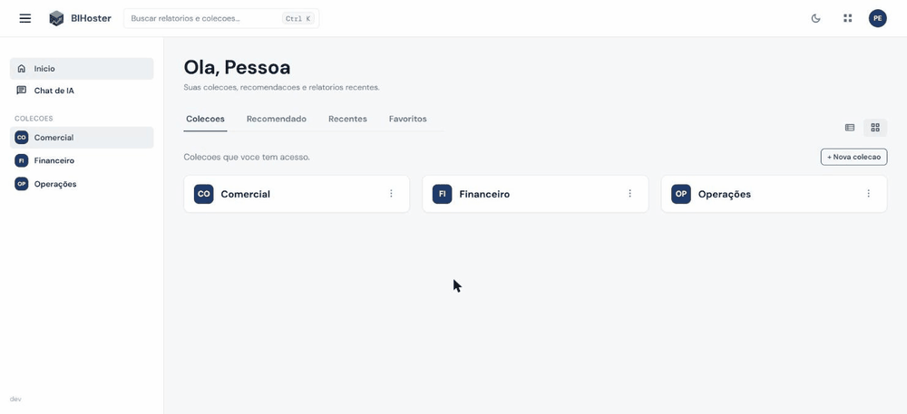

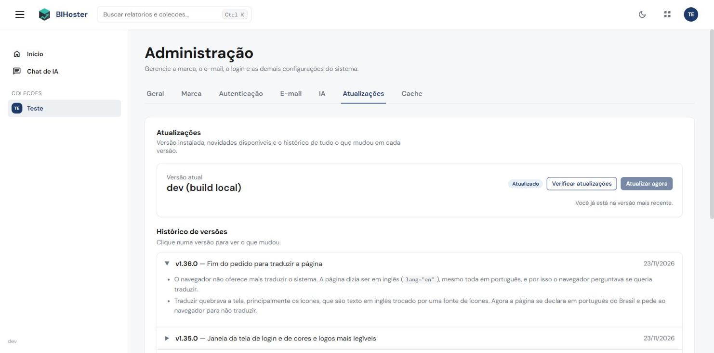

## 1.36.0 - 2026-11-23 - Fim do pedido para traduzir a página
- O navegador não oferece mais traduzir o sistema. A página dizia ser em inglês (`lang="en"`), mesmo toda em português, e por isso o navegador perguntava se queria traduzir.
- Traduzir quebrava a tela, principalmente os ícones, que são texto em inglês trocado por uma fonte de ícones. Agora a página se declara em português do Brasil e pede ao navegador para não traduzir.

## 1.35.0 - 2026-11-23 - Janela da tela de login e de cores e logos mais legíveis
- Na janela da tela de login, as duas opções de layout agora ficam uma embaixo da outra, com o texto inteiro. Antes ficavam lado a lado e o texto quebrava uma palavra por linha e saía do cartão.
- Na janela de cores e logos, o logo e o favicon ficam um por linha, e o botão de enviar imagem não quebra mais em duas linhas.

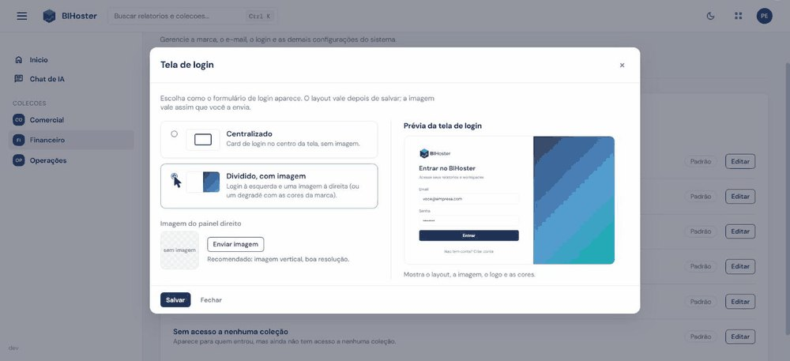

## 1.34.0 - 2026-11-23 - Cópia do banco antes de atualizar
- Ao atualizar pelo botão **Atualizar agora**, o sistema copia o banco (e o `.env`) para a pasta de backups do servidor antes de começar. Ficam guardadas as 5 cópias mais novas.
- Se a cópia falhar, a atualização nem começa, e a mensagem diz o motivo.
- A confirmação da atualização avisa sobre a cópia, e a auditoria registra o nome do arquivo.

## 1.33.0 - 2026-11-21 - Histórico de versões completo e botões de atualização
- O histórico da aba Atualizações agora traz todas as versões, de 1.0.0 até a atual, e bate sempre com a versão instalada. Antes ele vinha das Releases do GitHub, que pararam na 1.7.0.
- O texto de cada versão aceita imagens, que abrem ampliadas ao clicar.
- Novo botão **Verificar atualizações**, que consulta o GitHub na hora. O botão **Atualizar agora** aparece sempre para o administrador e explica por que está desligado quando não há versão nova ou a atualização automática está desligada.
- A versão mais nova passou a ser descoberta pelas tags do GitHub, e a CI agora cria a Release de cada versão a partir do mesmo histórico.
- Mostra as 10 versões mais recentes, com um botão para ver as anteriores.

- A atualização pelo botão ficou mais segura: ela passou a rodar num container auxiliar, que sobrevive à troca do backend, e usa o nome do projeto e os arquivos do compose (inclusive o override) da pilha que já está rodando, em vez de criar uma pilha paralela.

## 1.32.0 - 2026-11-21 - Servidor, teste e logo do e-mail em janelas
- Na aba E-mail, o servidor (SMTP), o envio de teste e o logo dos e-mails viraram linhas com o estado atual e um botão que abre a janela de edição.
- A janela do servidor só liga o Salvar quando algo muda e mostra o erro do servidor de e-mail dentro dela, sem perder o que foi digitado.

## 1.31.0 - 2026-11-21 - Cache e IA em lista com janela
- As abas Cache (aquecimento, status e reset) e IA (provedor, registro, relatórios, opções do chat e consumo) passaram para o estilo de lista com janela de edição.
- Os blocos da IA mantêm os próprios botões de salvar dentro da janela.

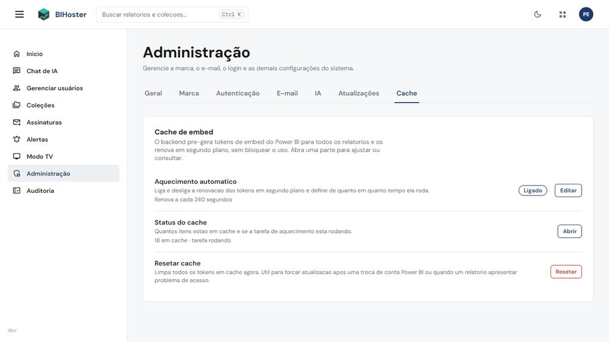

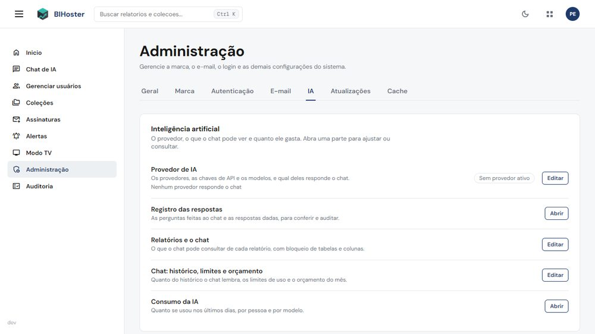

## 1.30.0 - 2026-11-21 - Geral e Autenticação em lista com janela
- As abas Geral (dados do aplicativo, HTTPS e homepage) e Autenticação (criação de conta e login com Google) agora mostram o estado de cada parte e abrem uma janela para editar.
- Desligar a criação de conta passou a valer depois de salvar, e não mais no clique.

## 1.29.0 - 2026-11-21 - Marca em lista com janela e prévia
- A aba Marca virou uma lista com uma linha por tela: cores e logos, tela de login, página não encontrada, "Algo deu errado", fora do horário e sem acesso a nenhuma coleção.
- Cada janela mostra a prévia da tela ao lado dos campos e salva só o que é dela. Cada linha indica se está no padrão ou personalizada.

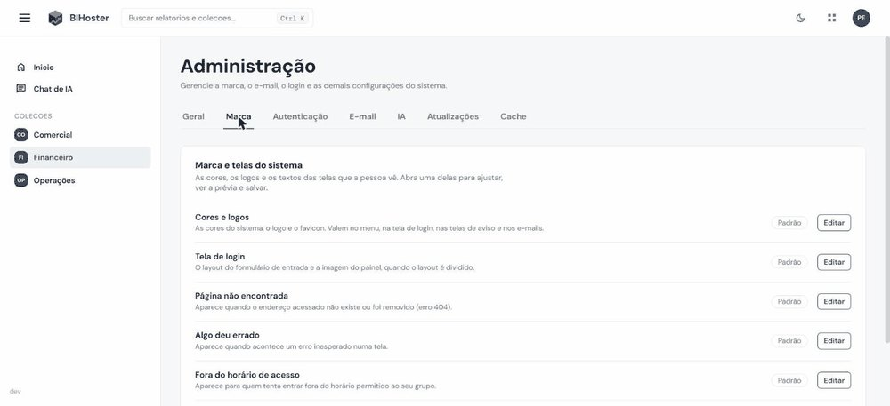

## 1.28.0 - 2026-11-21 - Logo próprio para os e-mails
- Dá para enviar um logo só para os e-mails, na aba E-mail. Sem ele, os e-mails usam o logo da marca.
- A prévia dos e-mails passou a mostrar a logo corretamente.

## 1.27.0 - 2026-11-21 - Todos os e-mails no layout da marca
- Os avisos de assinatura pausada e de alerta de medida agora têm texto editável na aba E-mail.
- Os relatórios enviados por assinatura ou pelo botão de enviar saem no mesmo layout HTML, com o assunto e a mensagem de cada envio.

## 1.26.0 - 2026-11-20 - E-mails em HTML com a marca e texto editável
- Os e-mails de conta e acesso (adicionado, convite, nova senha, pedido de mais tempo, horário liberado, pedido recusado e teste) saem em HTML com nome, cor e logo da marca, e também em texto puro.
- Na aba E-mail dá para ajustar assunto, mensagem e texto do botão de cada um, ver a prévia e mandar um teste.

## 1.25.0 - 2026-11-20 - Telas de aviso personalizáveis
- A tela "Algo deu errado" passou a usar o logo da marca.
- As telas de fora do horário de acesso e de sem acesso a nenhuma coleção têm título, mensagem e botão personalizáveis na aba Marca.

## 1.24.1 - 2026-11-20 - Acentos nos menus
- Acentos corrigidos nos rótulos do menu de módulos, da Auditoria e das abas da Administração.

## 1.24.0 - 2026-11-20 - Coleções e Assinaturas ganham página própria
- Coleções e Assinaturas saíram da Administração e ganharam página e item próprios no menu de módulos.
- O título da página passou de "Configurações" para "Administração".

## 1.23.1 - 2026-11-20 - E-mail para quem pediu mais tempo
- Quem pediu mais tempo fora do horário recebe um e-mail quando o pedido é aprovado (com o prazo) ou recusado.
- O grupo Administradores mostra o aviso de que nunca é limitado por horário.

## 1.23.0 - 2026-11-19 - Pedir mais tempo fora do horário
- Quem cai na tela de fora do horário pode escrever o motivo e pedir mais tempo.
- Quem tem a permissão de liberar acesso vê os pedidos em Gerenciar usuários e aprova por um prazo ou recusa. A liberação acaba sozinha.

## 1.22.0 - 2026-11-19 - Assinaturas e alertas: seus e de outras pessoas
- Assinaturas e alertas passaram a separar o que é da própria pessoa do que foi criado por outras, com permissões próprias para cada ação.
- As janelas mostram só as ações permitidas em cada item e quem o criou.

## 1.21.0 - 2026-11-19 - Horário de acesso
- Cada grupo pode ter faixas de dias e horas em que as pessoas podem usar o sistema, e cada pessoa pode ter uma exceção individual.
- Fora do horário a sessão cai e uma tela mostra o horário permitido e quando o acesso volta. Administradores nunca são limitados.

## 1.20.1 - 2026-11-19 - Foto e nomes padronizados
- A lista de pessoas traz a foto de perfil e os nomes aparecem formatados em todo o sistema.

## 1.20.0 - 2026-11-19 - Bloquear pessoas e e-mails de conta
- Menu de três pontinhos em cada pessoa para bloquear e desbloquear, e para enviar o aviso de acesso e o link de nova senha.
- Ao adicionar um membro dá para ligar o aviso por e-mail com o link para entrar.

## 1.19.1 - 2026-11-19 - Botão único em Gerenciar usuários
- Um botão só no topo de Gerenciar usuários: Adicionar membro na visão por membro e Adicionar grupo na visão por grupo.

## 1.19.0 - 2026-11-19 - Permissões separadas e Gerenciar usuários
- Cada coisa que dá para fazer ganhou a sua permissão, por grupo e por pessoa, no sistema todo ou numa coleção.
- Nova página Gerenciar usuários, fora da Administração, com membros, grupos e permissões juntos.
- Quem atualiza não perde nada: os papéis antigos são convertidos nas permissões novas no primeiro boot.

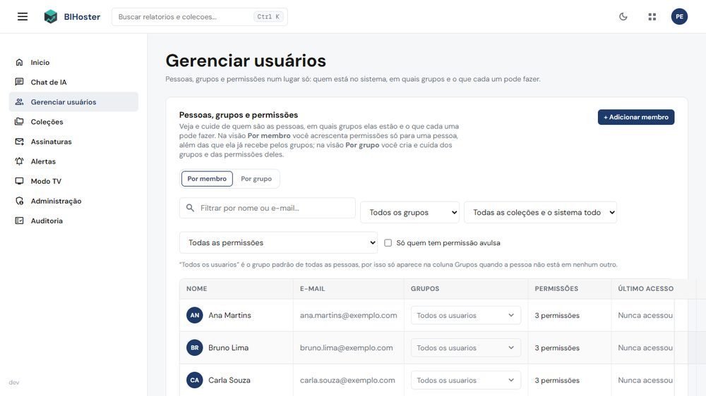

## 1.18.2 - 2026-11-17 - Tabela de membros
- A tabela de membros ganhou o mesmo estilo da tabela da auditoria e a busca ganhou um ícone.

## 1.18.1 - 2026-11-17 - Membros com paginação
- Aba Membros com paginação de 20 linhas, grupos num quadrado de tamanho fixo e escolha de grupos na janela de adicionar.

## 1.18.0 - 2026-11-17 - Marca com prévia e telas de erro
- A aba Marca mostra a prévia ao lado de cada assunto, e a imagem de login ficou compacta.
- Os textos das telas de erro passaram a ser personalizáveis.

## 1.17.3 - 2026-11-17 - Coleções com acesso dos grupos
- A aba Coleções ganhou ícones no menu e o acesso dos grupos dentro da janela de editar, gravado junto com o Salvar.

## 1.17.2 - 2026-11-17 - Aba Geral mais clara
- A aba Geral salva tudo com um Salvar só, avisa mudanças não salvas e confirma antes de ligar o HTTPS.
- Interruptores acessíveis, dicas nos campos e textos acentuados.

## 1.17.1 - 2026-11-17 - Segurança das dependências
- Atualização do `requests` para corrigir dois avisos de segurança do pip-audit.

## 1.17.0 - 2026-11-16 - Revisão das colunas que a IA pode ver
- O sistema sugere colunas para bloquear no chat por nome de dado pessoal e por texto com muitos valores. Só sinaliza: o administrador confirma.
- Relatório novo nasce fechado ao chat até ser revisado.
- Quando a pergunta precisa de uma coluna bloqueada, o chat recusa em linguagem de negócio e o registro do administrador mostra o desfecho.

## 1.16.0 - 2026-11-13 - Filtros por visual na auditoria
- Cada visual personalizado do painel de analíticos ganhou filtros próprios, combinados com os da página.
- Removida a aba Permissões antiga, que nenhuma regra do servidor usava.

## 1.15.1 - 2026-11-12 - Painel para quem só vê analíticos
- Quem só tem permissão de ver analíticos e não está em nenhuma coleção vê o painel, em vez da tela de boas-vindas.

## 1.15.0 - 2026-11-12 - Permissões dos analíticos
- Permissões por grupo para ver, criar, editar e excluir analíticos, aplicadas pelo servidor. Quem só lê não vê o e-mail das pessoas.

## 1.14.0 - 2026-11-12 - Visuais interativos
- Os visuais do painel mostram o valor ao passar o cursor e o clique neles filtra a página.

## 1.13.0 - 2026-11-11 - Visuais personalizados nos analíticos
- É possível adicionar, configurar e remover visuais no painel de analíticos, escolhendo tipo, medida, agrupamento, título e cor.

## 1.12.1 - 2026-11-11 - Segurança do frontend
- Dependências do frontend atualizadas para corrigir as vulnerabilidades apontadas pelo npm audit.

## 1.12.0 - 2026-11-11 - Painel de analíticos
- Painel de analíticos compartilhado, com visuais que se arrastam e redimensionam e ficam salvos no servidor.

## 1.11.0 - 2026-11-11 - Reverter ações pela auditoria
- Dá para reverter ações pela auditoria (coleção, relatório, acesso, permissões de grupo e membros), com aviso de conflito.

## 1.10.0 - 2026-11-11 - Página de Auditoria
- Página própria com registros filtráveis, analíticos, relatórios mais visitados e cartão da pessoa.

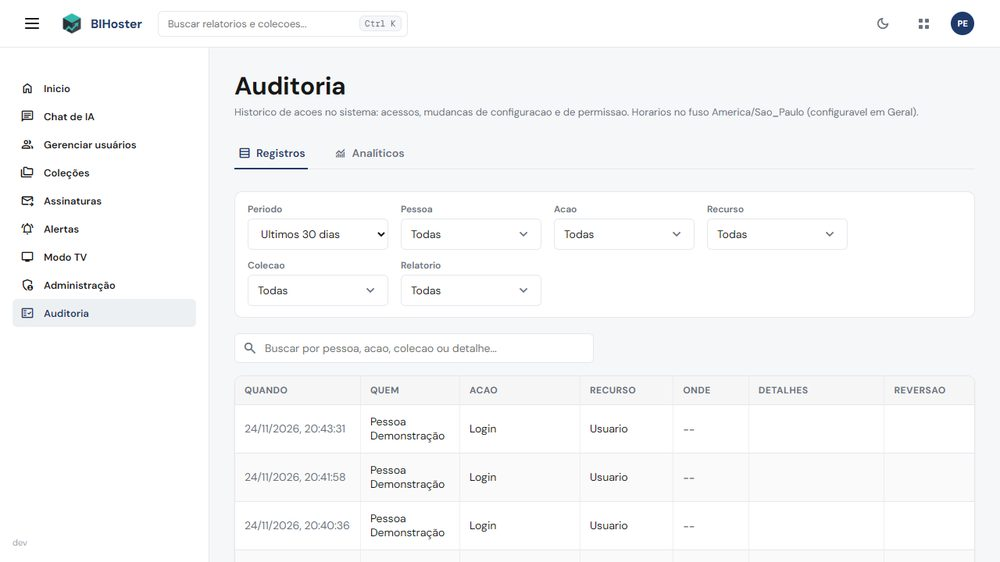

## 1.9.0 - 2026-11-11 - Login com Google traz a foto
- O login com Google traz a foto e um resumo da conta, e trava nome, e-mail e senha, que o Google controla.
- Nomes padronizados em todo o sistema.

## 1.8.4 - 2026-11-11 - Minha conta em página própria
- Minha conta virou uma página própria e as Configurações ficaram só com a administração.

## 1.8.3 - 2026-11-11 - Menu de módulos e menu do perfil
- O menu de módulos (administração e chat de IA) ficou separado do menu do perfil (minha conta e sair).

## 1.8.2 - 2026-11-11 - Versão no rodapé
- A versão em produção aparece no rodapé da barra lateral.

## 1.8.1 - 2026-11-10 - Registro das respostas da IA
- O administrador vê o registro das respostas do chat.
- Correções para modelos que raciocinam, mensagens de correção e linguagem de negócio nas respostas.

## 1.8.0 - 2026-11-10 - O que a IA enxerga por relatório
- Tela do que a IA enxerga em cada relatório, com orientações e colunas bloqueadas por relatório.
- O chat passa a considerar a página que está aberta, inclusive a imagem dela.

## 1.7.5 - 2026-11-10 - Chat de IA no relatório
- Botão do chat no relatório em tela cheia, painel mais estreito e menu que abre o painel.

## 1.7.4 - 2026-11-10 - Consultas mais precisas
- A IA passa a ver a quantidade de valores das colunas de texto e refaz a consulta quando agrupa em linhas demais.

## 1.7.3 - 2026-11-10 - Painel lateral do chat
- Indicador de espera com três pontinhos e frases que trocam com o tempo.
- Painel lateral do chat em meia tela, com a mesma conversa da página.

## 1.7.2 - 2026-11-10 - Respostas vazias da IA
- Quando o resultado volta vazio ou nulo, o chat refaz a consulta uma vez, com mais espaço para a resposta.

## 1.7.1 - 2026-11-10 - Provedores e modelos de IA
- Listas suspensas de provedores e de modelos na aba IA, com os modelos buscados no próprio provedor.

## 1.7.0 - 2026-11-10 - Chat de IA
- Página do chat com histórico, tabela de resultado e painel de consumo.
- Histórico de conversas com retenção, limite por dia e orçamento do OpenRouter.
- Motor do chat com escolha de relatório, DAX que se corrige e provedor padrão.
- Bloqueio de relatórios com segurança por linha (RLS) e permissões de IA por grupo.
- Cadastro de provedores de IA com a chave cifrada.

## 1.6.38 - 2026-11-06 - Embed sem fundo
- Fundo transparente e barra de ação oculta no relatório incorporado do Power BI.

## 1.6.37 - 2026-11-06 - Ajuste interno
- Ajuste interno de testes.

## 1.6.36 - 2026-11-06 - Painel do cache
- Aba Cache na administração para acompanhar e limpar o cache de embed do Power BI.

## 1.6.35 - 2026-11-06 - Miniaturas carregam
- Correção para as imagens estáticas serem entregues pelo servidor web.

## 1.6.34 - 2026-11-06 - Miniaturas pelo Power BI
- A miniatura do relatório é gerada em segundo plano a partir de uma exportação PNG do Power BI.

## 1.6.33 - 2026-11-06 - Miniaturas dos relatórios
- Miniaturas estáticas dos relatórios.

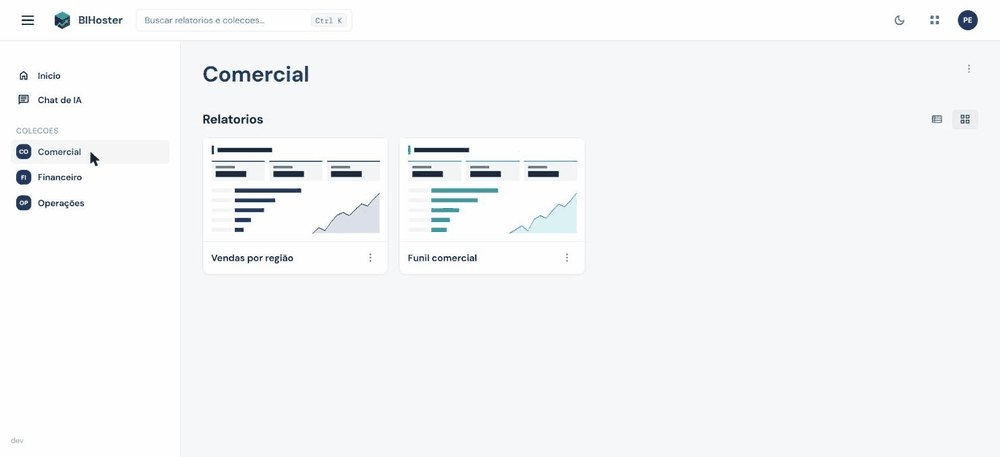

## 1.6.32 - 2026-11-06 - Seta da barra superior
- Seta de ocultar a barra superior maior.

## 1.6.31 - 2026-11-06 - Barra superior ocultável
- A barra superior pode ser ocultada no relatório em tela cheia.

## 1.6.30 - 2026-11-06 - Zoom corrigido
- O zoom do relatório usa o recurso do próprio Power BI, em vez de ampliar a tela.

## 1.6.29 - 2026-11-06 - Zoom em tela cheia
- Controles de zoom no relatório em tela cheia.

## 1.6.28 - 2026-11-05 - Alertas: leitura do valor
- Correção na leitura do valor da medida dos alertas.

## 1.6.27 - 2026-11-05 - Alertas: medidas do relatório
- Os alertas leem as medidas dos visuais do relatório incorporado.

## 1.6.26 - 2026-11-05 - Alertas: lista de medidas
- Ajuste na listagem de medidas dos alertas.

## 1.6.25 - 2026-11-05 - Alertas: lista de medidas
- Ajuste na listagem de medidas dos alertas.

## 1.6.24 - 2026-11-05 - Alertas: erro real
- Quando não consegue carregar as medidas, o alerta mostra o erro real.

## 1.6.23 - 2026-11-05 - Alertas de medidas
- Alertas de medidas do Power BI: o sistema confere o valor de uma medida e avisa por e-mail quando a condição é satisfeita.

## 1.6.22 - 2026-11-05 - Ajuste interno
- Ajuste interno de testes.

## 1.6.21 - 2026-11-05 - Assinaturas mais completas
- Prévia do e-mail antes de salvar a assinatura.
- Arquivos nomeados pelo nome da página ou do relatório e escolha das páginas de cada assinatura.

## 1.6.20 - 2026-11-05 - Ajuste interno
- Ajuste interno de testes.

## 1.6.19 - 2026-11-05 - Ajuste interno
- Ajuste interno de testes.

## 1.6.18 - 2026-11-05 - Níveis de permissão
- Sistema de níveis de permissão por usuário (substituído depois pelas permissões separadas).

## 1.6.17 - 2026-11-05 - Exportar CSV por visual
- Seletor de visual para exportar CSV e opção de mostrar o menu nativo dos visuais.

## 1.6.16 - 2026-11-05 - Exportar CSV
- Exportar os dados de uma tabela como CSV direto do visual incorporado.

## 1.6.15 - 2026-11-05 - Ícones no menu
- Ícones nos itens do menu e Configurações renomeado para Administração.

## 1.6.14 - 2026-11-05 - Tema e assinaturas
- Alternar o tema pelo ícone de lua e sol na barra superior.
- Visão de administrador das assinaturas, seletor de fuso e ordenação da lista.

## 1.6.13 - 2026-11-04 - Exportação em andamento
- Tratamento do aviso do Power BI de que a exportação ainda está em andamento.

## 1.6.12 - 2026-11-04 - Assinaturas por e-mail
- Envio recorrente de relatórios por e-mail, em dias e horários escolhidos.
- Tela de assinaturas no relatório em tela cheia.

## 1.6.11 - 2026-11-04 - Senha de app no e-mail
- O login SMTP mostra a resposta real do servidor e aceita senha de aplicativo com espaços.

## 1.6.10 - 2026-11-04 - Erros de e-mail mais claros
- A mensagem de erro do SMTP informa a etapa e a resposta do servidor.

## 1.6.9 - 2026-11-04 - Enviar relatório por e-mail
- Servidor SMTP nas configurações e envio de relatório exportado por e-mail, com acompanhamento do envio.
- Aba E-mail com envio de teste.

## 1.6.8 - 2026-11-04 - Tela cheia
- Cabeçalho com a logo, botão Sair com ícone e tela cheia como página própria.

## 1.6.7 - 2026-11-04 - Embed mais rápido
- Serviço do Power BI compartilhado, pré-carga e liberação do que está parado.

## 1.6.6 - 2026-11-04 - Status de atualização
- A última atualização dos dados sai dos cartões e aparece numa tabela pelo menu da coleção.

## 1.6.5 - 2026-11-04 - Menos consultas ao Power BI
- A última atualização da coleção inteira vem numa requisição só.
- O token sem RLS é compartilhado e os caches são aquecidos.

## 1.6.4 - 2026-11-03 - Mais rápido
- Compressão gzip para JS, CSS e JSON e reaproveitamento das conexões com o Power BI.
- O campo vazio do tempo do Modo TV volta ao valor salvo.

## 1.6.3 - 2026-11-03 - Segurança do login
- Troca da biblioteca de JWT por uma sem vulnerabilidade conhecida.

## 1.6.2 - 2026-10-27 - Correção
- Correção para bases que ainda não tinham as novas opções do relatório.

## 1.6.1 - 2026-10-27 - Opções de exibição do relatório
- Opções para mostrar o painel de filtros e a barra de navegação de páginas.
- A coleção abre em blocos por padrão.

## 1.6.0 - 2026-10-27 - Coleção única
- Quem tem acesso a uma coleção só entra direto nela.

## 1.5.1 - 2026-10-27 - Ajustes visuais da busca
- Destaque da busca em azul e título legível no tema escuro.

## 1.5.0 - 2026-10-14 - Minha conta e busca melhor
- A própria pessoa troca o nome e a senha.
- Busca com ranking por relevância, coleções nos resultados e destaque sem acento.

## 1.4.0 - 2026-10-14 - Várias abas do relatório
- Seleção de várias abas do relatório, com lista suspensa e barra de abas.

## 1.3.0 - 2026-09-29 - Modo TV e filtros
- Modo TV com pausa, setas e barra de progresso, e botões para reordenar os relatórios.
- Filtro por nome nas listas de relatórios e de coleções, favoritos mais rápidos e abas guardadas na URL.

## 1.2.0 - 2026-09-29 - Sessão e embed mais estáveis
- Sessão que se renova sozinha e token de embed renovado antes de vencer, sem recarregar o relatório.
- Modo TV atualiza a playlist sozinho.
- Auditoria guarda o e-mail de quem agiu e a aba Atualizações ganha cache e trava contra duas atualizações.
- Várias correções de busca, datas e telas.

## 1.1.0 - 2026-09-29 - Identidade visual
- Identidade visual do BIHoster: favicon, logo padrão e páginas de erro.
- Escolha de abas específicas ao publicar um relatório.
- Correção na migração automática do banco para instalações existentes.

## 1.0.0 - 2026-09-28 - Primeira versão
- Portal self-hosted para hospedar relatórios do Power BI, com login, controle de acesso e relatórios incorporados sem exigir conta no Power BI.
