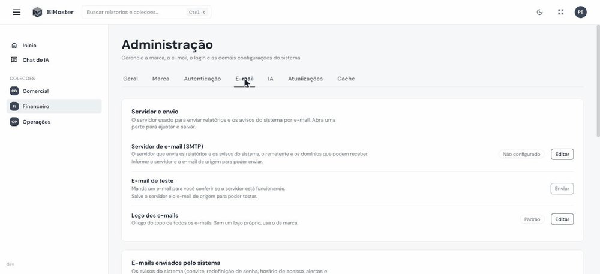
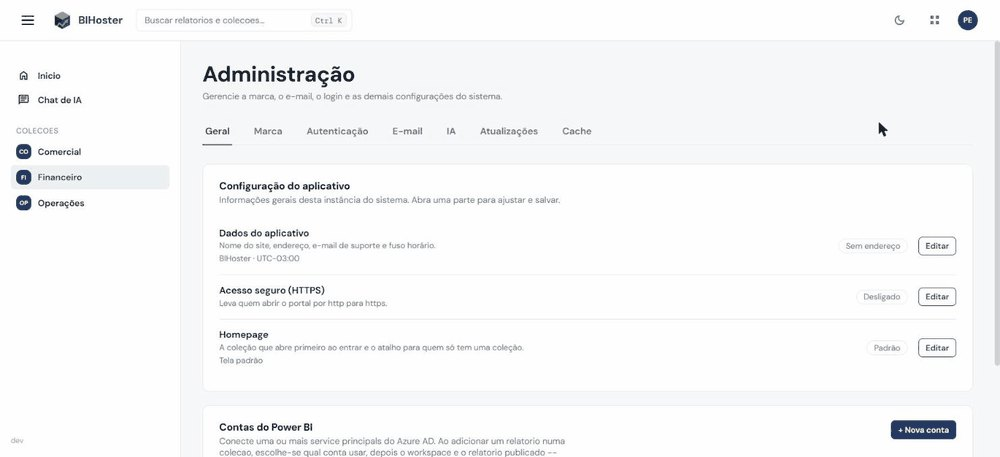
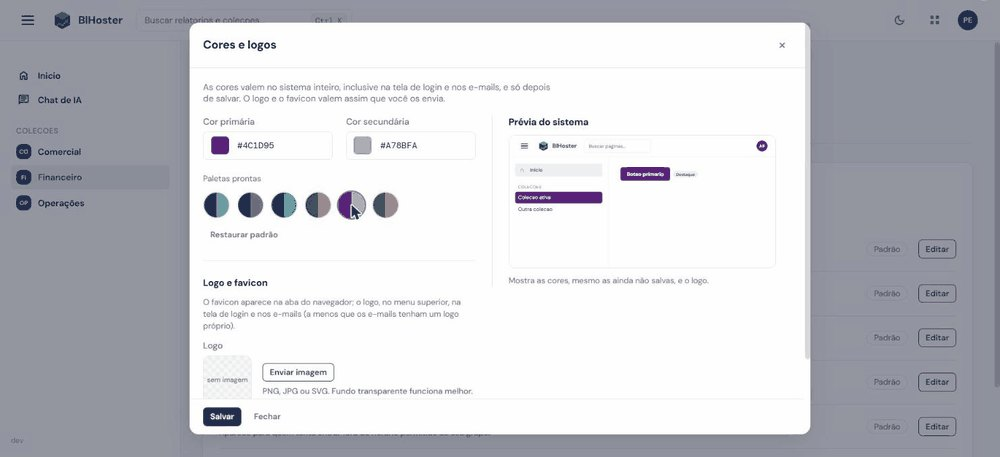

<!--
Histórico de versões do BIHoster. A aba Administração > Atualizações lê este arquivo, e a CI usa a seção da versão
para criar a Release no GitHub.

Formato de cada versão (a mais recente primeiro):

## 1.2.3 - 2026-01-31 - Título curto da versão
Texto em Markdown simples: listas com "- ", títulos com "### ", **negrito**, `código`, links http(s), imagens e GIFs.
Imagens e GIFs ficam em backend/app/changelog/img/ e entram do mesmo jeito: 
Aceita .png, .jpg e .gif (o GIF anima sozinho). Mantenha cada arquivo abaixo de uns 2 MB: eles vão dentro da imagem do sistema.

Toda tag nova precisa de uma seção aqui antes de ser criada.
-->

## 1.41.0 - 2026-11-23 - Exportar em janela, com Excel, PDF e imagem
- O botão **Exportar** do topo do relatório agora abre uma janela suspensa, onde você escolhe **o que exportar** (tabelas da página, página atual ou relatório inteiro) e **como** (CSV ou Excel para as tabelas; PDF ou imagem para a página e o relatório).
- **Excel (.xlsx):** as tabelas saem como planilha, com o cabeçalho em negrito e a primeira linha congelada. Ao exportar todas as tabelas, cada uma vira uma aba do mesmo arquivo.
- **PDF e imagem:** o Power BI gera o arquivo, o que leva alguns segundos (a janela mostra o andamento), e o download começa sozinho. Imagem do relatório inteiro vem num zip, com uma imagem por página.
- PDF e imagem pedem a permissão de exportar da coleção e não funcionam em relatórios com segurança por linha (RLS), como o envio por e-mail. Quem não tem a permissão continua exportando as tabelas.
- Cada exportação de PDF ou imagem fica registrada na auditoria.

## 1.40.0 - 2026-11-23 - Imagens do histórico pequenas e padronizadas
- As imagens e GIFs do histórico de versões agora aparecem todas no mesmo tamanho pequeno, alinhadas à esquerda, em vez de cada uma com um tamanho diferente.
- Clique numa imagem para ampliar numa janela, com os botões **Abrir em outra aba** e **Fechar** (o Esc e o clique fora também fecham).

## 1.39.0 - 2026-11-23 - Ações de alertas e assinaturas no menu dos 3 pontinhos
- Nas páginas **Alertas** e **Assinaturas**, as ações de cada linha (Enviar agora, Pausar ou Reativar, Editar e Excluir) ficam agora numa janela suspensa dos 3 pontinhos, cada opção com seu ícone. A tabela fica mais limpa e igual ao resto do sistema.
- O botão dos 3 pontinhos só aparece quando a pessoa pode usar alguma ação daquela linha, e a janela abre solta da tela, sem ser cortada nas últimas linhas.

## 1.38.0 - 2026-11-23 - Módulo Alertas e assinaturas editáveis
- Novo módulo **Alertas** (menu de módulos, para quem tem a permissão "Ver os alertas de todo o portal"): lista os alertas de todas as coleções, com filtro e resumo de quantos estão ativos ou com erro.
- Dá para **criar** um alerta novo escolhendo o relatório, **editar**, **pausar** ou **reativar** e **excluir**, tudo na própria página. Se o sistema não conseguir listar as medidas do relatório, basta digitar o nome da medida.
- A página **Assinaturas** deixou de ser só de consulta: agora também cria assinaturas (escolhendo o relatório), edita, pausa, envia na hora e exclui.
- Cada botão só aparece quando a pessoa pode usá-lo naquela coleção, e o servidor confere de novo. Quem só é editor de uma coleção continua mexendo apenas no que criou, a não ser que tenha a permissão de mexer no de outras pessoas.

## 1.37.0 - 2026-11-23 - Imagens e GIFs no histórico de versões
- O histórico passou a mostrar imagens das telas em várias versões (Marca, E-mail, Geral, miniaturas das coleções e a própria aba Atualizações). Clique numa imagem para vê-la ampliada.
- Também aceita GIFs animados, como o passeio pelo sistema abaixo.
- A imagem da aba Atualizações, que já estava prevista na versão 1.33.0, só chegava ao sistema agora.

## 1.36.0 - 2026-11-23 - Fim do pedido para traduzir a página
- O navegador não oferece mais traduzir o sistema. A página dizia ser em inglês (`lang="en"`), mesmo toda em português, e por isso o navegador perguntava se queria traduzir.
- Traduzir quebrava a tela, principalmente os ícones, que são texto em inglês trocado por uma fonte de ícones. Agora a página se declara em português do Brasil e pede ao navegador para não traduzir.

## 1.35.0 - 2026-11-23 - Janela da tela de login e de cores e logos mais legíveis
- Na janela da tela de login, as duas opções de layout agora ficam uma embaixo da outra, com o texto inteiro. Antes ficavam lado a lado e o texto quebrava uma palavra por linha e saía do cartão.
- Na janela de cores e logos, o logo e o favicon ficam um por linha, e o botão de enviar imagem não quebra mais em duas linhas.

## 1.34.0 - 2026-11-23 - Cópia do banco antes de atualizar
- Ao atualizar pelo botão **Atualizar agora**, o sistema copia o banco (e o `.env`) para a pasta de backups do servidor antes de começar. Ficam guardadas as 5 cópias mais novas.
- Se a cópia falhar, a atualização nem começa, e a mensagem diz o motivo.
- A confirmação da atualização avisa sobre a cópia, e a auditoria registra o nome do arquivo.

## 1.33.0 - 2026-11-21 - Histórico de versões completo e botões de atualização
- O histórico da aba Atualizações agora traz todas as versões, de 1.0.0 até a atual, e bate sempre com a versão instalada. Antes ele vinha das Releases do GitHub, que pararam na 1.7.0.
- O texto de cada versão aceita imagens, que abrem ampliadas ao clicar.
- Novo botão **Verificar atualizações**, que consulta o GitHub na hora. O botão **Atualizar agora** aparece sempre para o administrador e explica por que está desligado quando não há versão nova ou a atualização automática está desligada.
- A versão mais nova passou a ser descoberta pelas tags do GitHub, e a CI agora cria a Release de cada versão a partir do mesmo histórico.
- Mostra as 10 versões mais recentes, com um botão para ver as anteriores.

- A atualização pelo botão ficou mais segura: ela passou a rodar num container auxiliar, que sobrevive à troca do backend, e usa o nome do projeto e os arquivos do compose (inclusive o override) da pilha que já está rodando, em vez de criar uma pilha paralela.

## 1.32.0 - 2026-11-21 - Servidor, teste e logo do e-mail em janelas
- Na aba E-mail, o servidor (SMTP), o envio de teste e o logo dos e-mails viraram linhas com o estado atual e um botão que abre a janela de edição.
- A janela do servidor só liga o Salvar quando algo muda e mostra o erro do servidor de e-mail dentro dela, sem perder o que foi digitado.

## 1.31.0 - 2026-11-21 - Cache e IA em lista com janela
- As abas Cache (aquecimento, status e reset) e IA (provedor, registro, relatórios, opções do chat e consumo) passaram para o estilo de lista com janela de edição.
- Os blocos da IA mantêm os próprios botões de salvar dentro da janela.

## 1.30.0 - 2026-11-21 - Geral e Autenticação em lista com janela
- As abas Geral (dados do aplicativo, HTTPS e homepage) e Autenticação (criação de conta e login com Google) agora mostram o estado de cada parte e abrem uma janela para editar.
- Desligar a criação de conta passou a valer depois de salvar, e não mais no clique.

## 1.29.0 - 2026-11-21 - Marca em lista com janela e prévia
- A aba Marca virou uma lista com uma linha por tela: cores e logos, tela de login, página não encontrada, "Algo deu errado", fora do horário e sem acesso a nenhuma coleção.
- Cada janela mostra a prévia da tela ao lado dos campos e salva só o que é dela. Cada linha indica se está no padrão ou personalizada.

## 1.28.0 - 2026-11-21 - Logo próprio para os e-mails
- Dá para enviar um logo só para os e-mails, na aba E-mail. Sem ele, os e-mails usam o logo da marca.
- A prévia dos e-mails passou a mostrar a logo corretamente.

## 1.27.0 - 2026-11-21 - Todos os e-mails no layout da marca
- Os avisos de assinatura pausada e de alerta de medida agora têm texto editável na aba E-mail.
- Os relatórios enviados por assinatura ou pelo botão de enviar saem no mesmo layout HTML, com o assunto e a mensagem de cada envio.

## 1.26.0 - 2026-11-20 - E-mails em HTML com a marca e texto editável
- Os e-mails de conta e acesso (adicionado, convite, nova senha, pedido de mais tempo, horário liberado, pedido recusado e teste) saem em HTML com nome, cor e logo da marca, e também em texto puro.
- Na aba E-mail dá para ajustar assunto, mensagem e texto do botão de cada um, ver a prévia e mandar um teste.

## 1.25.0 - 2026-11-20 - Telas de aviso personalizáveis
- A tela "Algo deu errado" passou a usar o logo da marca.
- As telas de fora do horário de acesso e de sem acesso a nenhuma coleção têm título, mensagem e botão personalizáveis na aba Marca.

## 1.24.1 - 2026-11-20 - Acentos nos menus
- Acentos corrigidos nos rótulos do menu de módulos, da Auditoria e das abas da Administração.

## 1.24.0 - 2026-11-20 - Coleções e Assinaturas ganham página própria
- Coleções e Assinaturas saíram da Administração e ganharam página e item próprios no menu de módulos.
- O título da página passou de "Configurações" para "Administração".

## 1.23.1 - 2026-11-20 - E-mail para quem pediu mais tempo
- Quem pediu mais tempo fora do horário recebe um e-mail quando o pedido é aprovado (com o prazo) ou recusado.
- O grupo Administradores mostra o aviso de que nunca é limitado por horário.

## 1.23.0 - 2026-11-19 - Pedir mais tempo fora do horário
- Quem cai na tela de fora do horário pode escrever o motivo e pedir mais tempo.
- Quem tem a permissão de liberar acesso vê os pedidos em Gerenciar usuários e aprova por um prazo ou recusa. A liberação acaba sozinha.

## 1.22.0 - 2026-11-19 - Assinaturas e alertas: seus e de outras pessoas
- Assinaturas e alertas passaram a separar o que é da própria pessoa do que foi criado por outras, com permissões próprias para cada ação.
- As janelas mostram só as ações permitidas em cada item e quem o criou.

## 1.21.0 - 2026-11-19 - Horário de acesso
- Cada grupo pode ter faixas de dias e horas em que as pessoas podem usar o sistema, e cada pessoa pode ter uma exceção individual.
- Fora do horário a sessão cai e uma tela mostra o horário permitido e quando o acesso volta. Administradores nunca são limitados.

## 1.20.1 - 2026-11-19 - Foto e nomes padronizados
- A lista de pessoas traz a foto de perfil e os nomes aparecem formatados em todo o sistema.

## 1.20.0 - 2026-11-19 - Bloquear pessoas e e-mails de conta
- Menu de três pontinhos em cada pessoa para bloquear e desbloquear, e para enviar o aviso de acesso e o link de nova senha.
- Ao adicionar um membro dá para ligar o aviso por e-mail com o link para entrar.

## 1.19.1 - 2026-11-19 - Botão único em Gerenciar usuários
- Um botão só no topo de Gerenciar usuários: Adicionar membro na visão por membro e Adicionar grupo na visão por grupo.

## 1.19.0 - 2026-11-19 - Permissões separadas e Gerenciar usuários
- Cada coisa que dá para fazer ganhou a sua permissão, por grupo e por pessoa, no sistema todo ou numa coleção.
- Nova página Gerenciar usuários, fora da Administração, com membros, grupos e permissões juntos.
- Quem atualiza não perde nada: os papéis antigos são convertidos nas permissões novas no primeiro boot.

## 1.18.2 - 2026-11-17 - Tabela de membros
- A tabela de membros ganhou o mesmo estilo da tabela da auditoria e a busca ganhou um ícone.

## 1.18.1 - 2026-11-17 - Membros com paginação
- Aba Membros com paginação de 20 linhas, grupos num quadrado de tamanho fixo e escolha de grupos na janela de adicionar.

## 1.18.0 - 2026-11-17 - Marca com prévia e telas de erro
- A aba Marca mostra a prévia ao lado de cada assunto, e a imagem de login ficou compacta.
- Os textos das telas de erro passaram a ser personalizáveis.

## 1.17.3 - 2026-11-17 - Coleções com acesso dos grupos
- A aba Coleções ganhou ícones no menu e o acesso dos grupos dentro da janela de editar, gravado junto com o Salvar.

## 1.17.2 - 2026-11-17 - Aba Geral mais clara
- A aba Geral salva tudo com um Salvar só, avisa mudanças não salvas e confirma antes de ligar o HTTPS.
- Interruptores acessíveis, dicas nos campos e textos acentuados.

## 1.17.1 - 2026-11-17 - Segurança das dependências
- Atualização do `requests` para corrigir dois avisos de segurança do pip-audit.

## 1.17.0 - 2026-11-16 - Revisão das colunas que a IA pode ver
- O sistema sugere colunas para bloquear no chat por nome de dado pessoal e por texto com muitos valores. Só sinaliza: o administrador confirma.
- Relatório novo nasce fechado ao chat até ser revisado.
- Quando a pergunta precisa de uma coluna bloqueada, o chat recusa em linguagem de negócio e o registro do administrador mostra o desfecho.

## 1.16.0 - 2026-11-13 - Filtros por visual na auditoria
- Cada visual personalizado do painel de analíticos ganhou filtros próprios, combinados com os da página.
- Removida a aba Permissões antiga, que nenhuma regra do servidor usava.

## 1.15.1 - 2026-11-12 - Painel para quem só vê analíticos
- Quem só tem permissão de ver analíticos e não está em nenhuma coleção vê o painel, em vez da tela de boas-vindas.

## 1.15.0 - 2026-11-12 - Permissões dos analíticos
- Permissões por grupo para ver, criar, editar e excluir analíticos, aplicadas pelo servidor. Quem só lê não vê o e-mail das pessoas.

## 1.14.0 - 2026-11-12 - Visuais interativos
- Os visuais do painel mostram o valor ao passar o cursor e o clique neles filtra a página.

## 1.13.0 - 2026-11-11 - Visuais personalizados nos analíticos
- É possível adicionar, configurar e remover visuais no painel de analíticos, escolhendo tipo, medida, agrupamento, título e cor.

## 1.12.1 - 2026-11-11 - Segurança do frontend
- Dependências do frontend atualizadas para corrigir as vulnerabilidades apontadas pelo npm audit.

## 1.12.0 - 2026-11-11 - Painel de analíticos
- Painel de analíticos compartilhado, com visuais que se arrastam e redimensionam e ficam salvos no servidor.

## 1.11.0 - 2026-11-11 - Reverter ações pela auditoria
- Dá para reverter ações pela auditoria (coleção, relatório, acesso, permissões de grupo e membros), com aviso de conflito.

## 1.10.0 - 2026-11-11 - Página de Auditoria
- Página própria com registros filtráveis, analíticos, relatórios mais visitados e cartão da pessoa.

## 1.9.0 - 2026-11-11 - Login com Google traz a foto
- O login com Google traz a foto e um resumo da conta, e trava nome, e-mail e senha, que o Google controla.
- Nomes padronizados em todo o sistema.

## 1.8.4 - 2026-11-11 - Minha conta em página própria
- Minha conta virou uma página própria e as Configurações ficaram só com a administração.

## 1.8.3 - 2026-11-11 - Menu de módulos e menu do perfil
- O menu de módulos (administração e chat de IA) ficou separado do menu do perfil (minha conta e sair).

## 1.8.2 - 2026-11-11 - Versão no rodapé
- A versão em produção aparece no rodapé da barra lateral.

## 1.8.1 - 2026-11-10 - Registro das respostas da IA
- O administrador vê o registro das respostas do chat.
- Correções para modelos que raciocinam, mensagens de correção e linguagem de negócio nas respostas.

## 1.8.0 - 2026-11-10 - O que a IA enxerga por relatório
- Tela do que a IA enxerga em cada relatório, com orientações e colunas bloqueadas por relatório.
- O chat passa a considerar a página que está aberta, inclusive a imagem dela.

## 1.7.5 - 2026-11-10 - Chat de IA no relatório
- Botão do chat no relatório em tela cheia, painel mais estreito e menu que abre o painel.

## 1.7.4 - 2026-11-10 - Consultas mais precisas
- A IA passa a ver a quantidade de valores das colunas de texto e refaz a consulta quando agrupa em linhas demais.

## 1.7.3 - 2026-11-10 - Painel lateral do chat
- Indicador de espera com três pontinhos e frases que trocam com o tempo.
- Painel lateral do chat em meia tela, com a mesma conversa da página.

## 1.7.2 - 2026-11-10 - Respostas vazias da IA
- Quando o resultado volta vazio ou nulo, o chat refaz a consulta uma vez, com mais espaço para a resposta.

## 1.7.1 - 2026-11-10 - Provedores e modelos de IA
- Listas suspensas de provedores e de modelos na aba IA, com os modelos buscados no próprio provedor.

## 1.7.0 - 2026-11-10 - Chat de IA
- Página do chat com histórico, tabela de resultado e painel de consumo.
- Histórico de conversas com retenção, limite por dia e orçamento do OpenRouter.
- Motor do chat com escolha de relatório, DAX que se corrige e provedor padrão.
- Bloqueio de relatórios com segurança por linha (RLS) e permissões de IA por grupo.
- Cadastro de provedores de IA com a chave cifrada.

## 1.6.38 - 2026-11-06 - Embed sem fundo
- Fundo transparente e barra de ação oculta no relatório incorporado do Power BI.

## 1.6.37 - 2026-11-06 - Ajuste interno
- Ajuste interno de testes.

## 1.6.36 - 2026-11-06 - Painel do cache
- Aba Cache na administração para acompanhar e limpar o cache de embed do Power BI.

## 1.6.35 - 2026-11-06 - Miniaturas carregam
- Correção para as imagens estáticas serem entregues pelo servidor web.

## 1.6.34 - 2026-11-06 - Miniaturas pelo Power BI
- A miniatura do relatório é gerada em segundo plano a partir de uma exportação PNG do Power BI.

## 1.6.33 - 2026-11-06 - Miniaturas dos relatórios
- Miniaturas estáticas dos relatórios.

## 1.6.32 - 2026-11-06 - Seta da barra superior
- Seta de ocultar a barra superior maior.

## 1.6.31 - 2026-11-06 - Barra superior ocultável
- A barra superior pode ser ocultada no relatório em tela cheia.

## 1.6.30 - 2026-11-06 - Zoom corrigido
- O zoom do relatório usa o recurso do próprio Power BI, em vez de ampliar a tela.

## 1.6.29 - 2026-11-06 - Zoom em tela cheia
- Controles de zoom no relatório em tela cheia.

## 1.6.28 - 2026-11-05 - Alertas: leitura do valor
- Correção na leitura do valor da medida dos alertas.

## 1.6.27 - 2026-11-05 - Alertas: medidas do relatório
- Os alertas leem as medidas dos visuais do relatório incorporado.

## 1.6.26 - 2026-11-05 - Alertas: lista de medidas
- Ajuste na listagem de medidas dos alertas.

## 1.6.25 - 2026-11-05 - Alertas: lista de medidas
- Ajuste na listagem de medidas dos alertas.

## 1.6.24 - 2026-11-05 - Alertas: erro real
- Quando não consegue carregar as medidas, o alerta mostra o erro real.

## 1.6.23 - 2026-11-05 - Alertas de medidas
- Alertas de medidas do Power BI: o sistema confere o valor de uma medida e avisa por e-mail quando a condição é satisfeita.

## 1.6.22 - 2026-11-05 - Ajuste interno
- Ajuste interno de testes.

## 1.6.21 - 2026-11-05 - Assinaturas mais completas
- Prévia do e-mail antes de salvar a assinatura.
- Arquivos nomeados pelo nome da página ou do relatório e escolha das páginas de cada assinatura.

## 1.6.20 - 2026-11-05 - Ajuste interno
- Ajuste interno de testes.

## 1.6.19 - 2026-11-05 - Ajuste interno
- Ajuste interno de testes.

## 1.6.18 - 2026-11-05 - Níveis de permissão
- Sistema de níveis de permissão por usuário (substituído depois pelas permissões separadas).

## 1.6.17 - 2026-11-05 - Exportar CSV por visual
- Seletor de visual para exportar CSV e opção de mostrar o menu nativo dos visuais.

## 1.6.16 - 2026-11-05 - Exportar CSV
- Exportar os dados de uma tabela como CSV direto do visual incorporado.

## 1.6.15 - 2026-11-05 - Ícones no menu
- Ícones nos itens do menu e Configurações renomeado para Administração.

## 1.6.14 - 2026-11-05 - Tema e assinaturas
- Alternar o tema pelo ícone de lua e sol na barra superior.
- Visão de administrador das assinaturas, seletor de fuso e ordenação da lista.

## 1.6.13 - 2026-11-04 - Exportação em andamento
- Tratamento do aviso do Power BI de que a exportação ainda está em andamento.

## 1.6.12 - 2026-11-04 - Assinaturas por e-mail
- Envio recorrente de relatórios por e-mail, em dias e horários escolhidos.
- Tela de assinaturas no relatório em tela cheia.

## 1.6.11 - 2026-11-04 - Senha de app no e-mail
- O login SMTP mostra a resposta real do servidor e aceita senha de aplicativo com espaços.

## 1.6.10 - 2026-11-04 - Erros de e-mail mais claros
- A mensagem de erro do SMTP informa a etapa e a resposta do servidor.

## 1.6.9 - 2026-11-04 - Enviar relatório por e-mail
- Servidor SMTP nas configurações e envio de relatório exportado por e-mail, com acompanhamento do envio.
- Aba E-mail com envio de teste.

## 1.6.8 - 2026-11-04 - Tela cheia
- Cabeçalho com a logo, botão Sair com ícone e tela cheia como página própria.

## 1.6.7 - 2026-11-04 - Embed mais rápido
- Serviço do Power BI compartilhado, pré-carga e liberação do que está parado.

## 1.6.6 - 2026-11-04 - Status de atualização
- A última atualização dos dados sai dos cartões e aparece numa tabela pelo menu da coleção.

## 1.6.5 - 2026-11-04 - Menos consultas ao Power BI
- A última atualização da coleção inteira vem numa requisição só.
- O token sem RLS é compartilhado e os caches são aquecidos.

## 1.6.4 - 2026-11-03 - Mais rápido
- Compressão gzip para JS, CSS e JSON e reaproveitamento das conexões com o Power BI.
- O campo vazio do tempo do Modo TV volta ao valor salvo.

## 1.6.3 - 2026-11-03 - Segurança do login
- Troca da biblioteca de JWT por uma sem vulnerabilidade conhecida.

## 1.6.2 - 2026-10-27 - Correção
- Correção para bases que ainda não tinham as novas opções do relatório.

## 1.6.1 - 2026-10-27 - Opções de exibição do relatório
- Opções para mostrar o painel de filtros e a barra de navegação de páginas.
- A coleção abre em blocos por padrão.

## 1.6.0 - 2026-10-27 - Coleção única
- Quem tem acesso a uma coleção só entra direto nela.

## 1.5.1 - 2026-10-27 - Ajustes visuais da busca
- Destaque da busca em azul e título legível no tema escuro.

## 1.5.0 - 2026-10-14 - Minha conta e busca melhor
- A própria pessoa troca o nome e a senha.
- Busca com ranking por relevância, coleções nos resultados e destaque sem acento.

## 1.4.0 - 2026-10-14 - Várias abas do relatório
- Seleção de várias abas do relatório, com lista suspensa e barra de abas.

## 1.3.0 - 2026-09-29 - Modo TV e filtros
- Modo TV com pausa, setas e barra de progresso, e botões para reordenar os relatórios.
- Filtro por nome nas listas de relatórios e de coleções, favoritos mais rápidos e abas guardadas na URL.

## 1.2.0 - 2026-09-29 - Sessão e embed mais estáveis
- Sessão que se renova sozinha e token de embed renovado antes de vencer, sem recarregar o relatório.
- Modo TV atualiza a playlist sozinho.
- Auditoria guarda o e-mail de quem agiu e a aba Atualizações ganha cache e trava contra duas atualizações.
- Várias correções de busca, datas e telas.

## 1.1.0 - 2026-09-29 - Identidade visual
- Identidade visual do BIHoster: favicon, logo padrão e páginas de erro.
- Escolha de abas específicas ao publicar um relatório.
- Correção na migração automática do banco para instalações existentes.

## 1.0.0 - 2026-09-28 - Primeira versão
- Portal self-hosted para hospedar relatórios do Power BI, com login, controle de acesso e relatórios incorporados sem exigir conta no Power BI.
